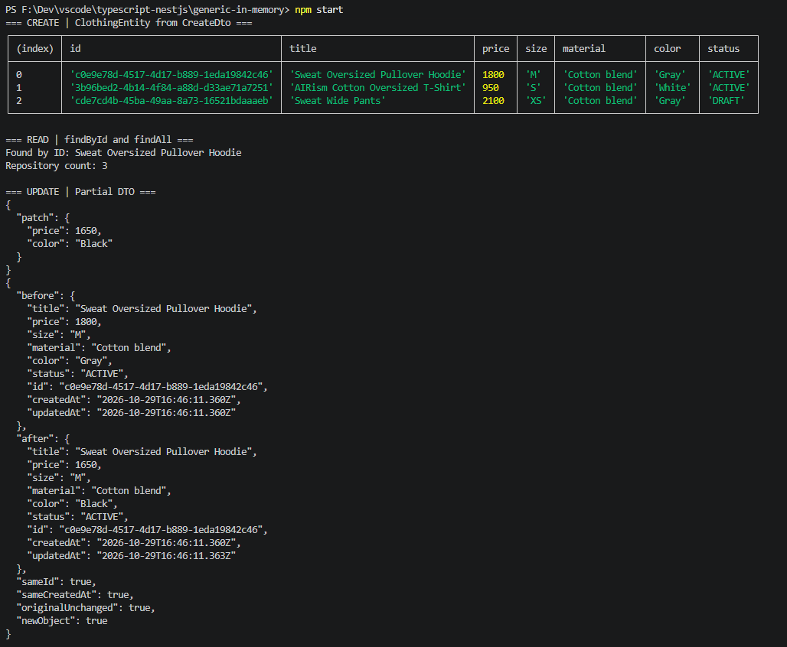
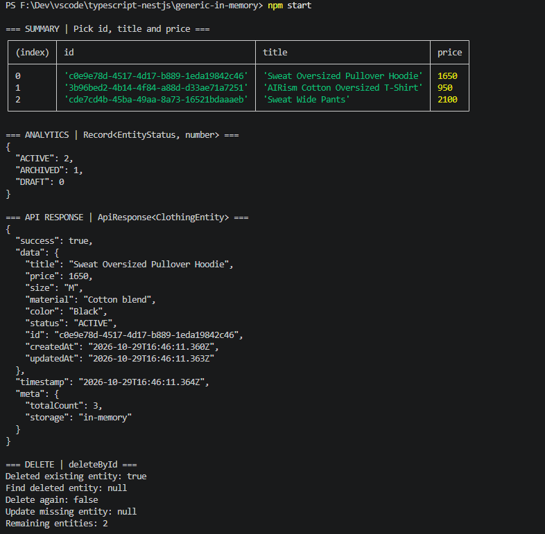
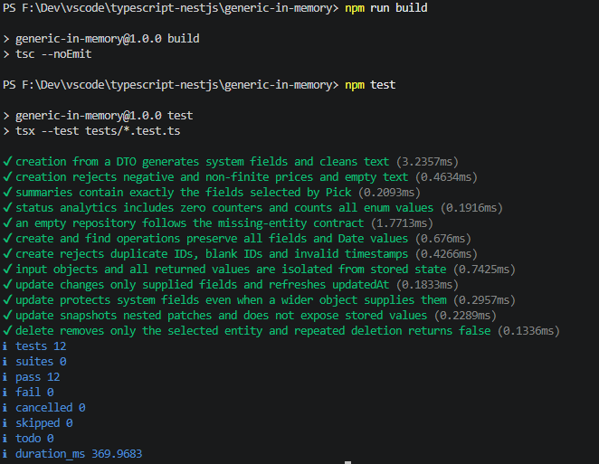

# Generic In-Memory Repository

Практична робота № 3

Узагальнення, декоратори та утиліти типів TypeScript

Реалізовано рівні 1 і 2 для варіанта 3 — сутність одягу `ClothingEntity`

Консольна програма демонструє типізований репозиторій у пам’яті, створення сутностей через DTO, пошук, часткове оновлення, витяг полів, аналітику статусів і видалення

## Запуск

Потрібні Node.js версії 18.18 або новішої та npm

Перейти до папки проєкту, підставивши фактичне розташування

```powershell
cd ".../generic-in-memory"
```

Встановити залежності та запустити демонстрацію

```powershell
npm ci
npm start
```

Програма виконує готовий сценарій без введення даних, усі записи зберігаються лише в оперативній пам’яті поточного процесу, повторний запуск починається з порожнього репозиторію

## Перевірка

```powershell
npm run build
npm test
```

`build` і `typecheck` виконують `tsc --noEmit`, перевіряючи типи без генерації JavaScript-файлів, для запуску використовується `tsx`

Тестовий набір містить 12 перевірок, успішний результат — `tests 12`, `pass 12`, `fail 0`

## Рівень 1 — Generic-типи й репозиторій

| Компонент                                  | Призначення                                                                               |
| ------------------------------------------ | ----------------------------------------------------------------------------------------- |
| `BaseEntity`                               | Обов’язкові `id: string`, `createdAt: Date`, `updatedAt: Date`                            |
| `ApiResponse<TData>`                       | `success`, типізовані `data`, `timestamp` і необов’язкові `meta: Record<string, unknown>` |
| `IRepository<T extends BaseEntity>`        | Контракт методів `create`, `findById`, `findAll`, `deleteById`, `update`                  |
| `InMemoryRepository<T extends BaseEntity>` | Реалізація контракту з внутрішньою `Map<string, T>`                                       |

`create` відхиляє порожній або повторний ідентифікатор та некоректні дати, `findById` повертає `null` для відсутнього запису, `deleteById` повертає результат видалення як `boolean`

Вхідні та вихідні дані копіюються через `structuredClone`, тому зміна отриманого об’єкта, вкладених даних або дат не змінює стан репозиторію, репозиторій призначений для сутностей із даними, які підтримують структуроване копіювання

## Рівень 2 — Enum та Utility Types

`ClothingEntity` розширює `BaseEntity` полями `title`, `price`, `size`, `material`, `color`, `status`, розміри одягу обмежені значеннями `XS`, `S`, `M`, `L`, `XL`

Строковий enum `EntityStatus` містить `Active = "ACTIVE"`, `Archived = "ARCHIVED"`, `Draft = "DRAFT"`

| Тип                  | Реалізація та використання                                                                      |
| -------------------- | ----------------------------------------------------------------------------------------------- |
| `CreateDto<T>`       | `Omit<T, keyof BaseEntity>` виключає `id`, `createdAt`, `updatedAt`                             |
| `UpdateDto<T>`       | `Partial<CreateDto<T>>` дозволяє передати лише змінювані поля                                   |
| `EntitySummary<T>`   | `Pick<T, "id" \| "title" \| "price">` описує коротке представлення                              |
| `EntityAnalytics<T>` | `Record<T["status"], number>` для `ClothingEntity` еквівалентний `Record<EntityStatus, number>` |

Обмеження generic-параметрів гарантують наявність потрібних полів, функція створення одягу формує UUID і часові мітки, перевіряє невід’ємну скінченну ціну та непорожні текстові поля

`update(id, patch)` повертає оновлену сутність або `null`, змінює лише передані предметні поля та встановлює `updatedAt: new Date()`, зберігаючи `id` і `createdAt` навіть за наявності зайвих системних полів у переданому об’єкті

`EntitySummary` визначає статичний тип, а `summarizeClothing` створює об’єкт лише з трьома вибраними полями під час виконання, лічильники аналітики включають усі статуси, навіть якщо їхня кількість дорівнює нулю

У `tsconfig.json` увімкнено `strict`, `noImplicitAny`, `strictNullChecks`, `noUncheckedIndexedAccess`, `experimentalDecorators` і `emitDecoratorMetadata`, декоратори та спеціалізований сервіс рівня 3 не реалізовані

## Демонстраційний сценарій

1. Створити три сутності з DTO — худі за `1800 грн`, футболку за `950 грн` і штани за `2100 грн`, ціни та характеристики є навчальними даними
2. Знайти худі за ідентифікатором та отримати список із трьох записів
3. Оновити лише ціну худі до `1650 грн` та колір до `Black`, порівняти початковий і новий об’єкти, ідентифікатор та дату створення
4. Змінити статус штанів із `DRAFT` на `ARCHIVED`
5. Вивести короткі представлення лише з `id`, `title`, `price`
6. Показати статистику `ACTIVE: 2`, `ARCHIVED: 1`, `DRAFT: 0`
7. Огорнути оновлений товар у `ApiResponse<ClothingEntity>` з часовою міткою та метаданими кількості записів
8. Видалити штани, перевірити `null` під час пошуку й оновлення видаленого запису та `false` під час повторного видалення, у репозиторії залишаються два записи

## Структура

| Шлях                | Призначення                                                         |
| ------------------- | ------------------------------------------------------------------- |
| `src/types/`        | Базова та предметна сутності, enum, generic API-відповідь і DTO     |
| `src/repositories/` | Контракт та універсальний репозиторій                               |
| `src/clothing.ts`   | Створення одягу з DTO, коротке представлення та підрахунок статусів |
| `src/index.ts`      | Послідовна демонстрація операцій у консолі                          |
| `tests/`            | Перевірки контракту, оновлень, ізоляції даних, DTO та аналітики     |

## Скріни

### 1 — Створення, пошук і часткове оновлення

Команда `npm start` створює три записи `ClothingEntity` через DTO, таблиця показує ідентифікатори, назви, ціни, розміри, матеріали, кольори та статуси, пошук за ідентифікатором повертає худі, а `findAll` — три сутності

Через `UpdateDto` змінено лише ціну худі з `1800` на `1650` та колір із `Gray` на `Black`, у блоках `before` і `after` видно збереження `id` та `createdAt` і нове значення `updatedAt`

Перевірки `sameId`, `sameCreatedAt`, `originalUnchanged` та `newObject` мають значення `true`, що підтверджує збереження системних полів і відсутність зміни початкового об’єкта



### 2 — Короткі представлення, аналітика, API-відповідь і видалення

Таблиця `SUMMARY` містить лише поля `id`, `title`, `price`, вибрані через `Pick`, ціна оновленого худі становить `1650`

Після зміни статусу штанів на `ARCHIVED` словник аналітики показує `ACTIVE: 2`, `ARCHIVED: 1`, `DRAFT: 0`, нульовий лічильник також присутній

Оновлений товар загорнуто в `ApiResponse<ClothingEntity>` з `success: true`, часовою міткою та метаданими `totalCount: 3` і `storage: "in-memory"`, ця відповідь сформована до видалення товару

Перше видалення повертає `true`, пошук і оновлення видаленого запису — `null`, повторне видалення — `false`, після цих операцій у репозиторії залишаються дві сутності



### 3 — Перевірка компіляції та тестів

Команда `npm run build` виконує `tsc --noEmit` і завершується без помилок, команда `npm test` запускає перевірки створення, пошуку, оновлення, захисту системних полів, ізоляції даних, видалення та аналітики

Підсумок — `tests 12`, `pass 12`, `fail 0`


