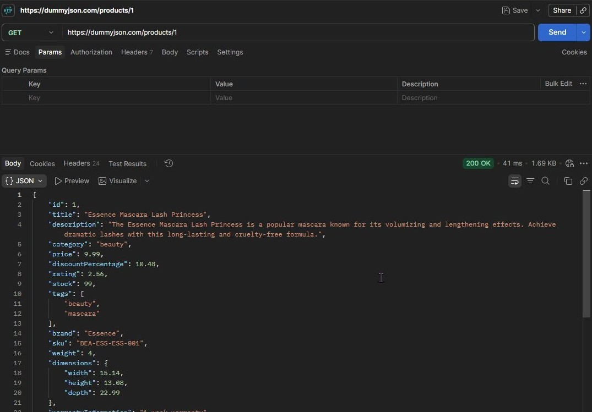
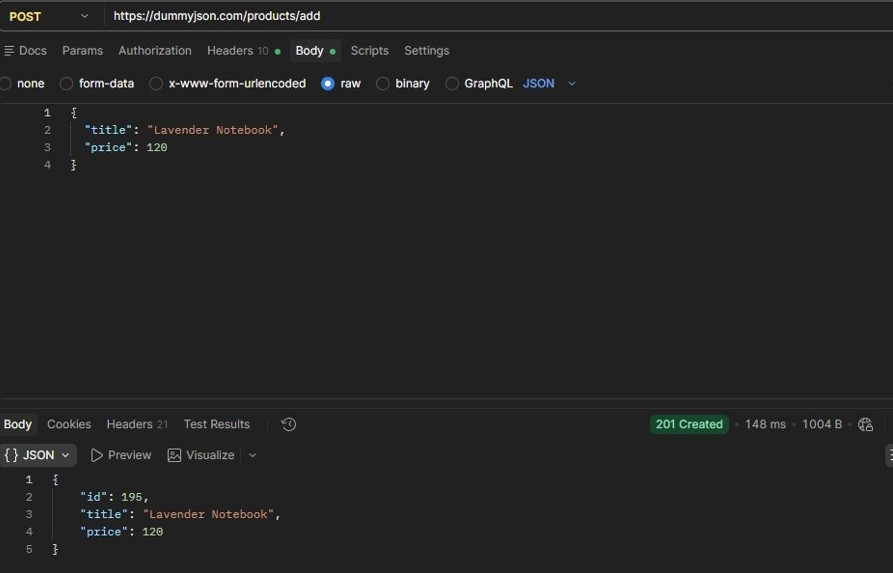
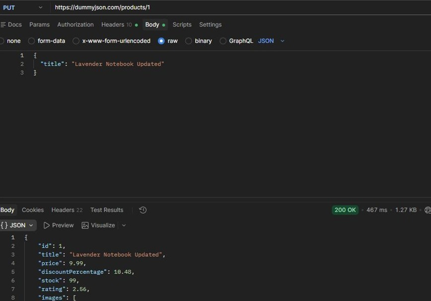
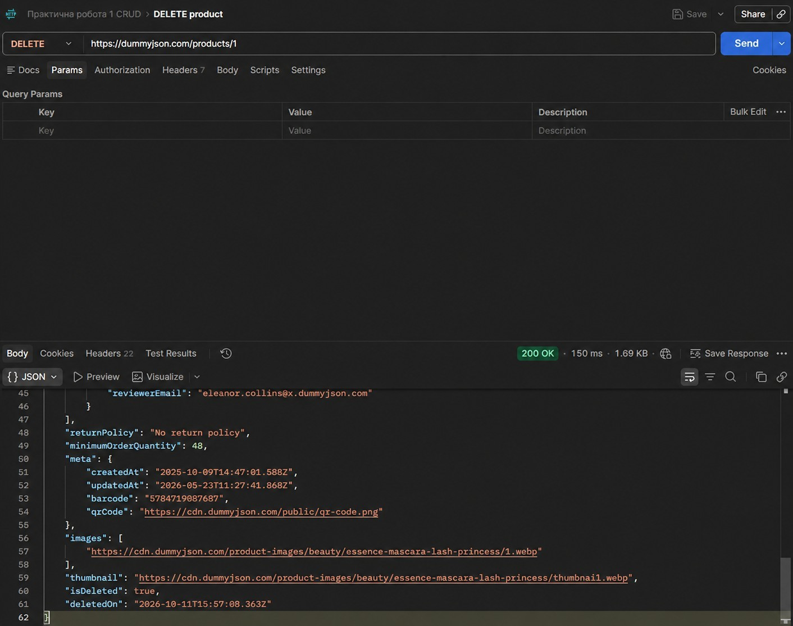
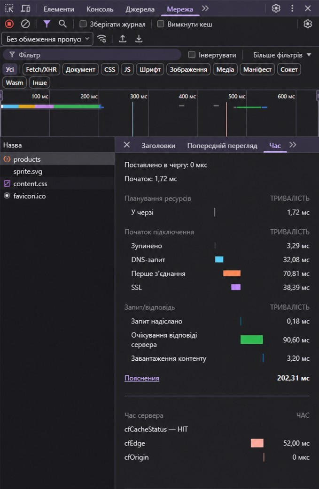
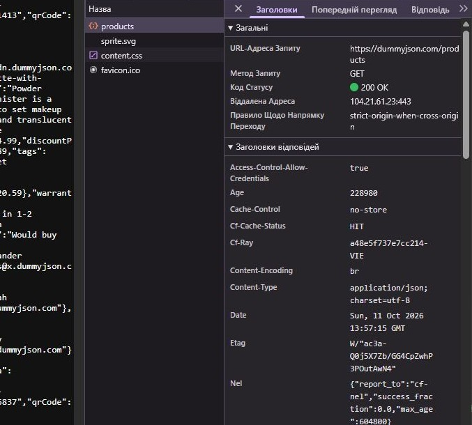
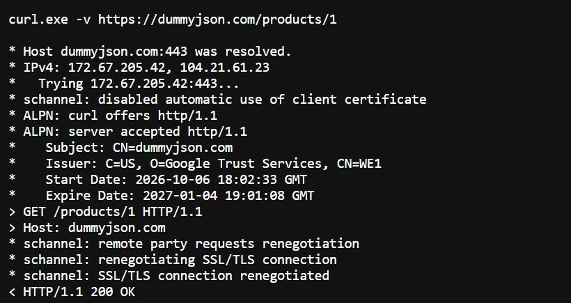
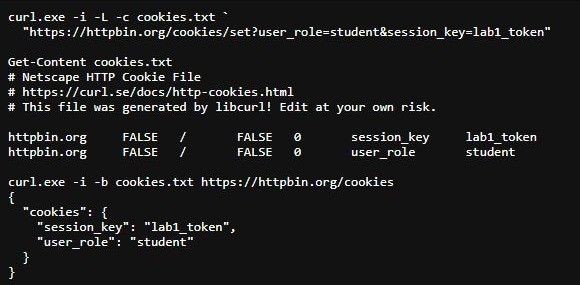
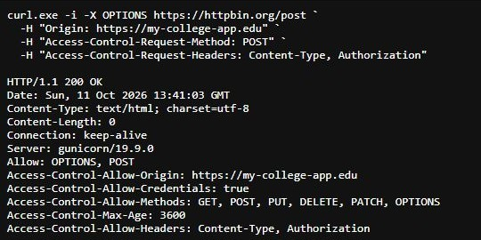

# HTTP Protocol Research

Практична робота №1

Дослідження мережевих протоколів засобами інструментів розробника

Досліджено HTTP-запити й відповіді, CRUD у Postman, заголовки та Timing у Chrome DevTools, консольні запити curl, HTTPS/TLS, cookies і CORS

Результати та вимірювання перенесено з матеріалів роботи за 11.10, наведені час, IP-адреси, сертифікат і розміри відповідають тим запускам і можуть відрізнятися під час повторення

## Повторення роботи

Потрібні curl, PowerShell і браузер із DevTools, для графічних запитів використати Postman або розширення REST Client у VS Code

Перейти до папки роботи, підставивши фактичне розташування

```powershell
cd "...\http-protocol-research"
curl.exe --version
```

Відкрити `commands.ps1` і виконувати команди по черзі з цієї папки, JSON для POST і PUT зберігається в `payloads`

Для Postman імпортувати `http-protocol-research.postman_collection.json`, для REST Client відкрити `requests.http` і виконувати запити через `Send Request`

Для аналізу браузера відкрити `https://dummyjson.com/products`, перейти до DevTools → Network, перезавантажити сторінку й обрати запит `products`, дослідити Headers і Timing

DummyJSON імітує зміни ресурсів, повторний GET після POST, PUT чи DELETE може повернути початкові дані

## Середовище вимірювань

| Компонент        | Версія або адреса                  |
| ---------------- | ---------------------------------- |
| ОС               | Windows 11 Pro, 64-bit, 10.0.26200 |
| Термінал         | PowerShell 7.6.5                   |
| curl             | 8.21.0, libcurl 8.21.0, Schannel   |
| Браузер          | Chrome 154, DevTools Network       |
| Графічний клієнт | Postman Web, Cloud Agent           |
| REST API         | `https://dummyjson.com`            |
| HTTP echo        | `https://httpbin.org`              |

## Структура

| Файл або каталог                                 | Призначення                                                          |
| ------------------------------------------------ | -------------------------------------------------------------------- |
| `README.md`                                      | Звіт, команди, аналіз і зображення результатів                       |
| `commands.ps1`                                   | Команди curl для всіх трьох рівнів                                   |
| `requests.http`                                  | Запити для VS Code REST Client                                       |
| `http-protocol-research.postman_collection.json` | Чотири CRUD-запити Postman                                           |
| `payloads/`                                      | JSON нового товару, оновлення, допису та навчального входу           |
| `curl-results.json`                              | Статуси, коди завершення й метрики 18 збережених curl-сценаріїв      |
| `logs/`                                          | Відібрані журнали TLS, cookies, CORS, перенаправлення та версії curl |
| `screens/`                                       | Зображення результатів із фінального звіту                           |

## Рівень 1 — Postman та DevTools

### CRUD-запити

У Postman створено CRUD, для POST і PUT вибрано Body → raw → JSON із заголовком `Content-Type: application/json`

| Метод і ресурс       | Статус        | Час, мс | Розмір у Postman |
| -------------------- | ------------- | ------: | ---------------- |
| `GET /products/1`    | `200 OK`      |      41 | 1,69 KB          |
| `POST /products/add` | `201 Created` |     148 | 1004 B           |
| `PUT /products/1`    | `200 OK`      |     467 | 1,27 KB          |
| `DELETE /products/1` | `200 OK`      |     150 | 1,69 KB          |

GET повернув товар `id=1`, поля `title`, `category`, `price`, `stock` і `brand` описують товар, `reviews`, `dimensions` і `meta` є вкладеними структурами

POST передав назву `Lavender Notebook` і числову ціну `120`, сервер повернув `201 Created` та новий `id=195`

PUT повернув товар `id=1` зі зміненим `title: "Lavender Notebook Updated"`, навчальний endpoint приймає одне змінене поле, хоча загальна семантика PUT — заміна представлення ресурсу, для часткових змін призначений PATCH

DELETE повернув `200 OK`, `isDeleted: true` та `deletedOn`, статус 200 допустимий для видалення з тілом результату, статус 204 означає успіх без тіла

Еквівалентні консольні запити

```powershell
curl.exe -i https://dummyjson.com/products/1
curl.exe -i -H "Content-Type: application/json" -d "@payloads/product.json" https://dummyjson.com/products/add
curl.exe -i -X PUT -H "Content-Type: application/json" -d "@payloads/update.json" https://dummyjson.com/products/1
curl.exe -i -X DELETE https://dummyjson.com/products/1
```

### Заголовки в DevTools

| Поле            | Значення зі звіту                                                                                                                         |
| --------------- | ----------------------------------------------------------------------------------------------------------------------------------------- |
| Request URL     | `https://dummyjson.com/products`                                                                                                          |
| Request Method  | `GET`                                                                                                                                     |
| Status Code     | `200 OK`                                                                                                                                  |
| Remote Address  | `104.21.61.23:443`                                                                                                                        |
| content-type    | `application/json; charset=utf-8`                                                                                                         |
| date            | `Sun, 11 Oct 2026 13:57:15 GMT`                                                                                                           |
| server          | `cloudflare`                                                                                                                              |
| etag            | `W/"ac3a-Q0j5X7Zb/GG4CpZwhP3POutAwN4"`                                                                                                    |
| accept          | `text/html,application/xhtml+xml,application/xml;q=0.9,image/avif,image/webp,image/apng,*/*;q=0.8,application/signed-exchange;v=b3;q=0.7` |
| accept-encoding | `gzip, deflate, br, zstd`                                                                                                                 |
| user-agent      | `Mozilla/5.0 (Windows NT 10.0; Win64; x64) AppleWebKit/537.36 (KHTML, like Gecko) Chrome/154.0.0.0 Safari/537.36`                         |

### Timing у Chrome

| Фаза                               | Тривалість, мс |
| ---------------------------------- | -------------: |
| Queueing                           |           1,72 |
| Stalled                            |           3,29 |
| DNS Lookup                         |          32,08 |
| Initial connection                 |          70,81 |
| SSL, входить до Initial connection |          38,39 |
| Request sent                       |           0,18 |
| Waiting for server response        |          90,60 |
| Content Download                   |           3,20 |
| Загальна тривалість                |         202,31 |

Найдовша фаза Waiting становить приблизно 44,8% загального часу, Initial connection — 35,0%, DNS — 15,9%, завантаження JSON — 1,6%, затримка переважно пов’язана з підготовкою з’єднання й очікуванням відповіді

SSL уже входить до Initial connection, додавати ці два значення як незалежні фази не потрібно, Waiting включає мережеву затримку та обробку запиту

Server-Timing показав `cfCacheStatus: HIT`, `cfEdge: 52.00 ms` і `cfOrigin: 0 us`, різниця між сумою округлених фаз і загальним часом може включати інтервали між фазами й округлення

## Рівень 2 — Діагностика curl

### GET із query-параметрами та POST із JSON

```powershell
curl.exe -i "https://dummyjson.com/users?limit=2&select=firstName,email"
curl.exe -i -H "Content-Type: application/json" -d "@payloads/post.json" https://dummyjson.com/posts/add
```

URL із `&` взято в лапки, щоб PowerShell передав його як один аргумент

GET повернув двох користувачів з полями `firstName` та `email`, а також їхні ID, POST створив імітований допис із `id=252`, `title: "Practical work 1"`, `userId: 1` і статусом `201`

### HEAD і контрольовані помилки

```powershell
curl.exe -I https://dummyjson.com/products
curl.exe -i https://httpbin.org/status/404
curl.exe -i https://httpbin.org/status/500
```

HEAD повернув `200`, `size_download: 0`, `Content-Type: application/json; charset=utf-8`, `Server: cloudflare`, `Cache-Control: no-store` та ETag ресурсу

`-I` надсилає HEAD без тіла відповіді, `-i` додає заголовки до звичайного виведення

Запити до `/status/404` та `/status/500` повернули відповідно `404 NOT FOUND` і `500 INTERNAL SERVER ERROR`, це очікувані результати досліду, без `--fail` curl не перетворює HTTP 4xx/5xx на ненульовий код завершення процесу

### Bearer-автентифікація

У `payloads/login.json` використано публічний навчальний обліковий запис DummyJSON

```json
{ "username": "emilys", "password": "emilyspass" }
```

Отримати токен і передати його наступному запиту

```powershell
$login = curl.exe -sS -H "Content-Type: application/json" -d "@payloads/login.json" https://dummyjson.com/auth/login | ConvertFrom-Json
$token = $login.accessToken
curl.exe -i -H "Authorization: Bearer $token" https://dummyjson.com/auth/me
```

Вхід і `/auth/me` повернули `200`, захищений endpoint підтвердив користувача `id=1`, `username: emilys`, `firstName: Emily`, `lastName: Johnson`

`ConvertFrom-Json` перетворює JSON на об’єкт PowerShell, токен читається з `accessToken`, готові access/refresh tokens не зберігаються в цій папці

### Метрики продуктивності

```powershell
curl.exe -sS -o NUL -w "DNS: %{time_namelookup}s\nTCP: %{time_connect}s\nTLS: %{time_appconnect}s\nTTFB: %{time_starttransfer}s\nTotal: %{time_total}s\n" https://dummyjson.com/products
```

| Метрика            | Значення, с |
| ------------------ | ----------: |
| time_namelookup    |    0.016061 |
| time_connect       |    0.046919 |
| time_appconnect    |    0.096279 |
| time_pretransfer   |    0.096371 |
| time_starttransfer |    0.135833 |
| time_total         |    0.140064 |

Значення curl накопичувальні від початку операції, для окремих фаз використано різниці

| Фаза                                    | Розрахунок                              | Тривалість, мс |
| --------------------------------------- | --------------------------------------- | -------------: |
| DNS                                     | `time_namelookup`                       |         16,061 |
| TCP після DNS                           | `time_connect - time_namelookup`        |         30,858 |
| TLS                                     | `time_appconnect - time_connect`        |         49,360 |
| Очікування після готовності до передачі | `time_starttransfer - time_pretransfer` |         39,462 |
| Завантаження                            | `time_total - time_starttransfer`       |          4,231 |

Очікування після pretransfer містить передачу запиту, мережеву затримку та обробку сервером, це не ізольований час виконання серверного коду

Postman, Chrome DevTools і curl виконували окремі запити, тому їхні тривалості й розміри не повинні збігатися

## Рівень 3 — HTTPS/TLS, cookies і CORS

### TLS та перенаправлення HTTP

```powershell
curl.exe -v https://dummyjson.com/products/1
curl.exe -I http://dummyjson.com/products/1
```

| Параметр                               | Результат збереженого досліду      |
| -------------------------------------- | ---------------------------------- |
| TCP endpoint                           | `172.67.205.42:443`                |
| Subject                                | `CN=dummyjson.com`                 |
| Видавець                               | Google Trust Services, WE1         |
| Початок чинності                       | `06.10.2026 18:02:33 GMT`          |
| Завершення чинності                    | `04.01.2027 19:01:08 GMT`          |
| SAN                                    | `dummyjson.com`, `*.dummyjson.com` |
| ssl_verify_result                      | `0`                                |
| Протокол окремого Python ssl-з’єднання | `TLSv1.3`                          |
| Cipher окремого Python ssl-з’єднання   | `TLS_AES_256_GCM_SHA384`           |

Журнал [tls.verbose.txt](logs/tls.verbose.txt) показує TCP, ALPN, HTTP та повідомлення Schannel, [tls-extra.json](logs/tls-extra.json) зберігає результат додаткового незалежного TLS-з’єднання з перевіркою сертифіката

Schannel у збереженому verbose-журналі не показав ClientHello, ServerHello й погоджений cipher окремими повідомленнями, тому дані Python ssl не приписуються тому самому curl-з’єднанню

На рівні протоколу ClientHello повідомляє підтримувані версії TLS, набори шифрів і SNI, ServerHello визначає погоджені параметри, перевірка сертифіката підтверджує довірений ланцюжок, строк дії та ім’я сервера, після узгодження ключів і Finished прикладні дані передаються зашифрованими

Префікси curl `*`, `>` та `<` позначають діагностичні повідомлення, вихідні заголовки запиту та вхідні заголовки відповіді

Незахищений HTTP-запит повернув

```http
HTTP/1.1 301 Moved Permanently
Location: https://dummyjson.com/products/1
```

Без `-L` curl не переходить за перенаправленням, чутливі дані потрібно одразу надсилати через HTTPS, редирект не шифрує початковий HTTP-запит

### Cookie jar

```powershell
curl.exe -i -L -c cookies.txt "https://httpbin.org/cookies/set?user_role=student&session_key=lab1_token"
Get-Content cookies.txt
curl.exe -i -b cookies.txt https://httpbin.org/cookies
```

`-c` зберігає cookies, `-L` дозволяє перейти за редиректом після встановлення, `-b` читає jar та додає Cookie до наступного запиту

Збережений формат Netscape

```text
# Netscape HTTP Cookie File
httpbin.org FALSE / FALSE 0 session_key lab1_token
httpbin.org FALSE / FALSE 0 user_role student
```

| Поле           | Значення                                             |
| -------------- | ---------------------------------------------------- |
| Домен          | `httpbin.org`                                        |
| Піддомени      | `FALSE`                                              |
| Шлях           | `/`                                                  |
| Secure         | `FALSE`                                              |
| Строк дії Unix | `0`, session cookie без встановленої дати завершення |
| Імена          | `session_key`, `user_role`                           |
| Значення       | `lab1_token`, `student`                              |

Повторний запит повернув `200` та [підтвердження cookies](logs/cookie_check.json)

```json
{
  "cookies": {
    "session_key": "lab1_token",
    "user_role": "student"
  }
}
```

Сервер встановлює cookie через Set-Cookie, клієнт повертає лише пари ім’я=значення в Cookie, атрибути Path, Secure, HttpOnly та SameSite керують поведінкою клієнта й не повторюються в цьому заголовку

Jar дозволяє передати session cookies між окремими процесами curl, значення `0` тут не означає дату 01.01.1970

### Атрибути безпеки cookies

```powershell
curl.exe -i -G --data-urlencode "Set-Cookie=session_id=xyz789; Path=/; Secure; HttpOnly; SameSite=Strict" https://httpbin.org/response-headers
```

Відповідь зі статусом `200` містить

```http
Set-Cookie: session_id=xyz789; Path=/; Secure; HttpOnly; SameSite=Strict
```

| Атрибут         | Призначення                                                                                         |
| --------------- | --------------------------------------------------------------------------------------------------- |
| HttpOnly        | Забороняє доступ до cookie через `document.cookie`, зменшує ризик викрадення сесії JavaScript-кодом |
| Secure          | Обмежує передавання cookie захищеним транспортом                                                    |
| SameSite=Strict | Обмежує міжсайтове надсилання cookie та зменшує ризик CSRF                                          |

HttpOnly не усуває сам XSS і не забороняє браузеру надсилати cookie, SameSite=None потребує Secure, у curl jar-досліді перевірено збереження й передачу cookies, браузерний контроль SameSite не вимірювався

### CORS preflight

```powershell
curl.exe -i -X OPTIONS https://httpbin.org/post -H "Origin: https://my-college-app.edu" -H "Access-Control-Request-Method: POST" -H "Access-Control-Request-Headers: Content-Type, Authorization"
```

Збережена відповідь має статус `200 OK`, повні заголовки наведено в [cors.headers.txt](logs/cors.headers.txt)

| Заголовок                              | Значення                                 |
| -------------------------------------- | ---------------------------------------- |
| Origin, запит                          | `https://my-college-app.edu`             |
| Access-Control-Request-Method, запит   | `POST`                                   |
| Access-Control-Request-Headers, запит  | `Content-Type, Authorization`            |
| Access-Control-Allow-Origin, відповідь | `https://my-college-app.edu`             |
| Access-Control-Allow-Methods           | `GET, POST, PUT, DELETE, PATCH, OPTIONS` |
| Access-Control-Allow-Headers           | `Content-Type, Authorization`            |
| Access-Control-Allow-Credentials       | `true`                                   |
| Access-Control-Max-Age                 | `3600`                                   |

Сервер дозволив запитаний origin, метод і заголовки, curl лише моделює OPTIONS і показує відповідь, застосування політики CORS до JavaScript виконує браузер

Preflight потрібен не для кожного POST, але `Content-Type: application/json`, Authorization і методи PUT чи DELETE спричиняють його за звичайних умов міжджерельного fetch

## Підсумок перевірок

У збережених результатах є 18 curl-сценаріїв, усі процеси завершилися з кодом `0`, HTTP 404 і 500 очікувані, журнал HEAD підтверджує нульовий розмір завантаженого тіла

| Перевірка         | Результат                                                                 |
| ----------------- | ------------------------------------------------------------------------- |
| CRUD Postman      | GET 200, POST 201 з ID, PUT 200 зі зміненим title, DELETE 200 з isDeleted |
| DevTools          | Headers і Timing зафіксовані у звіті та зображеннях                       |
| curl              | GET, POST, PUT, DELETE, HEAD, OPTIONS, query, JSON, заголовки й метрики   |
| Bearer            | Вхід 200, `/auth/me` 200                                                  |
| HTTPS             | Перевірка сертифіката успішна, параметри окремого ssl-з’єднання збережені |
| HTTP              | 301 із Location на HTTPS                                                  |
| Cookies           | Jar збережено та передано, echo повернув обидва значення                  |
| Cookie attributes | Set-Cookie містить Secure, HttpOnly і SameSite=Strict                     |
| CORS              | OPTIONS 200 із дозволами origin, методу та заголовків                     |

## Скріни та витяги зі звіту

### 1 — GET у Postman

Товар `id=1`, відповідь `200 OK`, час 41 мс і розмір 1,69 KB



### 2 — POST у Postman

JSON із title та price, відповідь `201 Created` і новий `id=195`



### 3 — PUT у Postman

Передано новий title, відповідь `200 OK` повертає змінену назву товару



### 4 — DELETE у Postman

Відповідь `200 OK` містить `isDeleted: true` та `deletedOn`



### 5 — Timing Chrome DevTools

Показано DNS, Initial connection, SSL, Waiting, Content Download і загальну тривалість 202,31 мс



### 6 — Headers Chrome DevTools

Показано URL, GET, статус 200, адресу сервера й частину заголовків відповіді



### 7 — Витяг трасування TLS

Відтворений у фінальному звіті фрагмент журналу показує IP, порт 443, ALPN, сертифікат і відповідь HTTP, оригінальний текст збережено в `logs/tls.verbose.txt`



### 8 — Витяг дослідження cookies

Показано команди з `-c` і `-b`, формат jar та echo обох cookies, збережену JSON-відповідь наведено в `logs/cookie_check.json`



### 9 — Витяг CORS preflight

Показано OPTIONS із трьома заголовками запиту, статус 200 і дозволи сервера, текстова відповідь збережена в `logs/cors.headers.txt`


