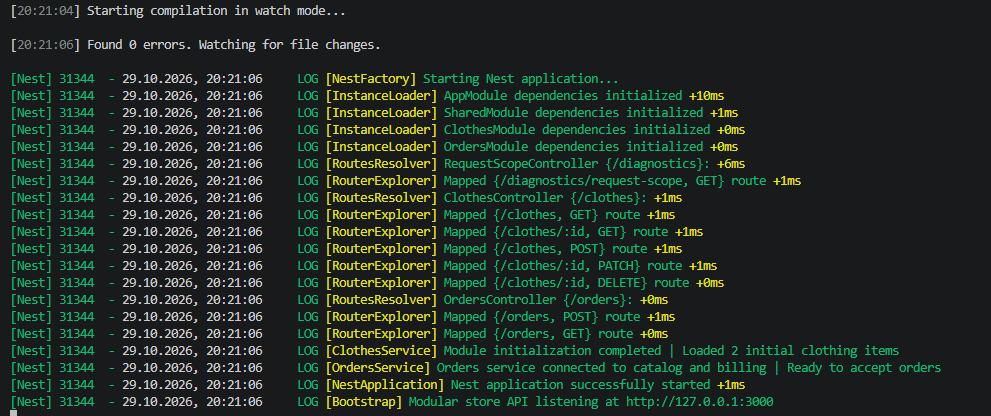
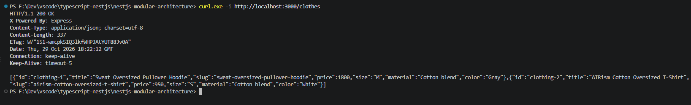
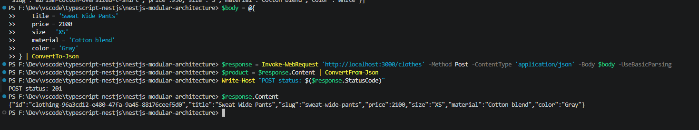
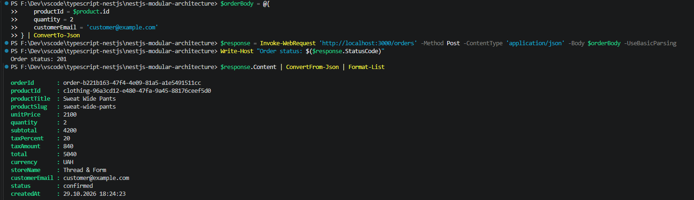
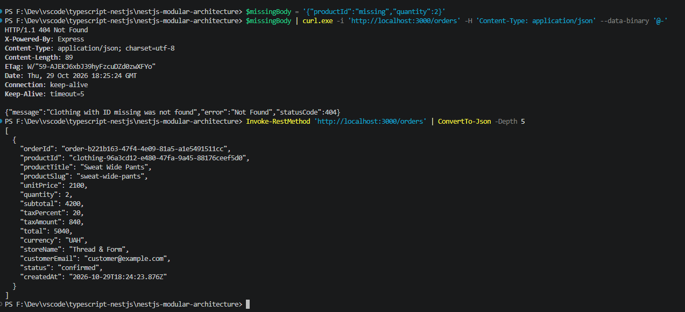
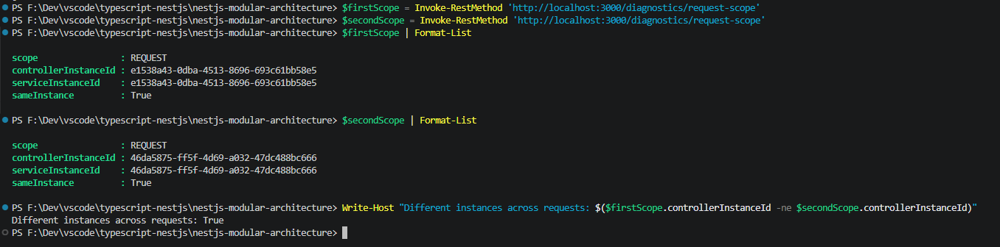
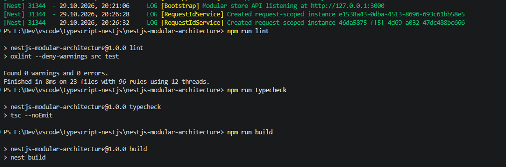
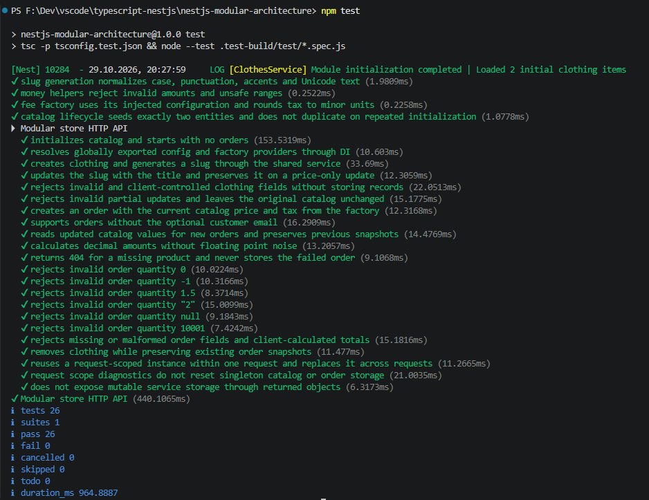

# Modular Store API

Практична робота № 5

Модульна архітектура та ін’єкція залежностей у NestJS

Реалізовано всі три рівні для варіанта 3 — каталог одягу `ClothesModule`, замовлення `OrdersModule` та спільні провайдери `SharedModule`

Це REST API з JSON-відповідями та in-memory сховищем, вебінтерфейсу й бази даних немає

## Запуск

Потрібні Node.js версії 22 або новішої та npm, перевірено на Node.js 24

Перейти до папки проєкту, підставивши фактичне розташування

```powershell
cd ".../nestjs-modular-architecture"
npm ci
npm run start:dev
```

У другому терміналі перевірити каталог

```powershell
curl.exe -i http://localhost:3000/clothes
```

Сервер слухає `127.0.0.1:3000`, змінні середовища `HOST` і `PORT` дозволяють змінити адресу й порт, наприклад

```powershell
$env:PORT = '3001'
npm run start:dev
```

Зупинити сервер через Ctrl+C, після нового запуску каталог знову містить два початкові товари, список замовлень порожній

Для запуску зібраного застосунку виконати

```powershell
npm run build
npm run start:prod
```

## Архітектура модулів

Модулі та сервіси згенеровано через Nest CLI, кореневий `AppModule` містить лише `imports: [SharedModule, ClothesModule, OrdersModule]`, предметні контролери та сервіси в ньому не реєструються

| Модуль          | Реєстрація та взаємодія                                                                                          |
| --------------- | ---------------------------------------------------------------------------------------------------------------- |
| `ClothesModule` | Імпортує `SharedModule`, реєструє `ClothesController` і `ClothesService`, експортує `ClothesService`             |
| `OrdersModule`  | Імпортує `ClothesModule` та `SharedModule`, реєструє власні контролер і сервіс                                   |
| `SharedModule`  | Глобальний модуль зі `SlugService`, конфігурацією, фабрикою розрахунку податку, валідацією та діагностикою scope |

`OrdersService` отримує `ClothesService` через constructor injection та викликає `findOne(productId)`, щоб перевірити наявність товару й отримати його поточну ціну, відсутність товару спричиняє `NotFoundException`

`SharedModule` експортує `SlugService`, `STORE_CONFIG`, `FEE_CALCULATOR` та `RequestIdService`, основні feature-модулі явно імпортують спільний модуль

## Рівень 1 — Feature Module та slug

`ClothingEntity` містить `id`, `title`, `slug`, `price`, `size`, `material`, `color`

`ClothesService` отримує `SlugService` через конструктор, при створенні товару генерує slug, при зміні назви через PATCH оновлює його, зміна лише ціни не змінює slug

`generateSlug` переводить текст у нижній регістр, очищує пунктуацію, прибирає діакритичні знаки та замінює розділювачі дефісами, літери Unicode зберігаються, наприклад `Cotton & Linen Shirt` перетворюється на `cotton-linen-shirt`

Назва лише з пунктуації не створює порожній slug — API повертає `400`

## Рівень 2 — Замовлення та Custom Providers

Конфігурацію оголошено в `src/shared/config/app-config.provider.ts` під токеном `STORE_CONFIG` через `useValue`

| Поле              | Значення        |
| ----------------- | --------------- |
| `storeName`       | `Thread & Form` |
| `defaultCurrency` | `UAH`           |
| `taxPercent`      | `20`            |

Об’єкт конфігурації заморожено через `Object.freeze`, ці значення є навчальними налаштуваннями магазину

Провайдер `FEE_CALCULATOR` створюється через `useFactory`, отримує конфігурацію за допомогою `inject: [STORE_CONFIG]` та повертає `calculateTax(amount: number): number`

`OrdersService` отримує конфігурацію та калькулятор через `@Inject(STORE_CONFIG)` і `@Inject(FEE_CALCULATOR)`

Створення замовлення виконується так

1. Прийняти `productId` та `quantity` із `CreateOrderDto`
2. Знайти товар у `ClothesService`
3. Розрахувати `subtotal = unitPrice × quantity`
4. Розрахувати `taxAmount` через фабричний провайдер
5. Додати податок — `total = subtotal + taxAmount`
6. Зберегти замовлення й повернути `201 Created`

Замовлення зберігає назву, slug і ціну товару на момент оформлення, наступні зміни або видалення товару не змінюють вже оформлені замовлення, нові замовлення використовують актуальні значення каталогу

Розрахунки виконуються в цілих копійках, податок округлюється до копійки, для точного множення ставки використовується `BigInt`, у JSON повертаються звичайні числа, переповнення підтримуваного діапазону відхиляється

`customerEmail` — додаткове опціональне поле з перевіркою email, як у прикладі ТЗ, замовлення також можна створити лише з `productId` і `quantity`

## Рівень 3 — Lifecycle Hooks та Scope

`ClothesService` реалізує `OnModuleInit`, в цьому хуку завантажуються два початкові товари з готовими slug та виводиться повідомлення про завершення ініціалізації

| ID           | Товар                           | Ціна | Slug                              |
| ------------ | ------------------------------- | ---: | --------------------------------- |
| `clothing-1` | Sweat Oversized Pullover Hoodie | 1800 | `sweat-oversized-pullover-hoodie` |
| `clothing-2` | AIRism Cotton Oversized T-Shirt |  950 | `airism-cotton-oversized-t-shirt` |

Ціни й характеристики є навчальними даними, повторний виклик хука не дублює початкові записи

`OrdersService` також реалізує `OnModuleInit` і повідомляє про підключення до каталогу та розрахунків і готовність приймати замовлення

`RequestIdService` має `Scope.REQUEST` і створює UUID для нового екземпляра, його ін’єкцію перевіряє маршрут `GET /diagnostics/request-scope`

```powershell
curl.exe -s http://localhost:3000/diagnostics/request-scope
curl.exe -s http://localhost:3000/diagnostics/request-scope
```

В одній відповіді `controllerInstanceId` та `serviceInstanceId` збігаються і `sameInstance` дорівнює `true`, у наступному запиті ID змінюється, створення екземпляра також видно в логах `RequestIdService`

Діагностичний контролер і сервіс виділено в `shared/request-scope`, оскільки request scope поширюється на споживачів залежності, каталог і замовлення залишаються singleton-провайдерами, щоб їхнє сховище зберігалося між запитами та працювали lifecycle hooks

## Маршрути та валідація

| Метод і шлях                     | Призначення                                         | HTTP-статус      |
| -------------------------------- | --------------------------------------------------- | ---------------- |
| `GET /clothes`                   | Усі товари                                          | 200              |
| `GET /clothes/:id`               | Товар за ID                                         | 200 або 404      |
| `POST /clothes`                  | Створення товару й slug                             | 201 або 400      |
| `PATCH /clothes/:id`             | Часткове оновлення товару                           | 200, 400 або 404 |
| `DELETE /clothes/:id`            | Видалення без тіла відповіді                        | 204 або 404      |
| `POST /orders`                   | Замовлення з податком                               | 201, 400 або 404 |
| `GET /orders`                    | Список замовлень                                    | 200              |
| `GET /diagnostics/request-scope` | Перевірка життєвого циклу request-scoped екземпляра | 200              |

Глобальний `ValidationPipe` перевіряє DTO-класи, відхиляє зайві поля та `null` замість очікуваних значень, текстові поля очищуються від зовнішніх пробілів

Ціна має бути JSON-числом від `0` до `1 000 000 000` із максимум двома десятковими знаками, кількість — JSON-цілим числом від `1` до `10 000`, клієнт не може задавати `id`, `slug`, податок чи підсумкову суму

Кореневий шлях `/` не має контролера, для перевірки сервера використовувати `/clothes`

## Ручна перевірка через requests.http

Відкрити `requests.http` у VS Code із розширенням REST Client, запустити сервер і виконувати запити через Send Request

У файлі `###` розділяє запити, `# @name createClothing` є службовою директивою для використання ID створеного товару в наступних запитах

1. Виконати GET `/clothes` і перевірити два початкові товари
2. Виконати іменований POST `/clothes`, перевірити `201` і `slug: "sweat-wide-pants"`
3. Створити замовлення цього товару з кількістю `2`, очікуються `subtotal: 4200`, `taxAmount: 840`, `total: 5040`, `currency: "UAH"`
4. Виконати POST `/orders` із `productId: "missing"`, очікується `404`, замовлення не додається
5. Отримати GET `/orders` і перевірити збережене замовлення
6. Двічі виконати діагностичний GET і порівняти ID екземплярів
7. Через PATCH змінити назву товару на Gray Wide Pants і ціну на `2000`, новий slug — `gray-wide-pants`
8. Створити ще одне замовлення з кількістю `2`, очікуються `subtotal: 4000`, `taxAmount: 800`, `total: 4800`, перше замовлення залишається незмінним
9. Перевірити відхилення кількості `0` зі статусом `400`
10. Видалити створений товар і перевірити `404` при наступній спробі замовити його

## Автоматичні перевірки

```powershell
npm run lint
npm run typecheck
npm run build
npm test
```

Лінтер і перевірка типів завершуються без помилок, збірка створює `dist`, тести компілюються в `.test-build` і виконуються вбудованим тестовим засобом Node.js

Успішно пройдено 26 тестів — `pass 26`, `fail 0`

Перевірено slug, початкове наповнення через lifecycle hook, DI конфігурації й фабрики, CRUD каталогу, валідацію, актуальність ціни в замовленні, точність розрахунку податку, незмінність оформлених замовлень, відповіді 400/404/204 та поведінку request scope

HTTP-тести запускають окремий застосунок на випадковому loopback-порту для кожної перевірки й закривають його після виконання, порт `3000` та дані запущеного вручну сервера не використовуються

Аудит `npm audit --omit=dev` не виявив вразливостей у залежностях виконання, повний аудит повідомляє про три пов’язані попередження низької важливості в dev-залежностях Nest CLI → fork-ts-checker-webpack-plugin → deepmerge

## Файли проєкту

| Шлях                         | Призначення                                                   |
| ---------------------------- | ------------------------------------------------------------- |
| `src/app.module.ts`          | Кореневий імпорт трьох модулів                                |
| `src/main.ts`                | Запуск, конфігурація адреси й порту, коректне завершення      |
| `src/clothes/`               | Модуль, модель, DTO, контролер і сервіс каталогу              |
| `src/orders/`                | Модуль, модель, DTO, контролер і сервіс замовлень             |
| `src/shared/config/`         | Токен і `useValue`-провайдер конфігурації                     |
| `src/shared/billing/`        | `useFactory`-калькулятор податку та грошові обчислення        |
| `src/shared/request-scope/`  | Провайдер із request scope та діагностичні контролер і сервіс |
| `src/shared/validation/`     | Спільне очищення тексту DTO                                   |
| `src/shared/slug.service.ts` | Генерація slug                                                |
| `test/store.spec.ts`         | Перевірки провайдерів та наскрізні HTTP-тести                 |
| `requests.http`              | Послідовність запитів для ручного тестування                  |

## Скріни

### 1 — Запуск модулів і lifecycle hooks

Компіляція в режимі розробки завершується з `Found 0 errors`, NestJS ініціалізує `SharedModule`, `ClothesModule` та `OrdersModule` і реєструє маршрути каталогу, замовлень та діагностики

У логах `ClothesService` показано завантаження двох початкових товарів, повідомлення `OrdersService` підтверджує готовність приймати замовлення після підключення до каталогу й розрахунків



### 2 — Початкові товари зі slug

Запит `GET /clothes` повертає `200 OK` та два товари з ідентифікаторами `clothing-1` і `clothing-2`, для обох збережено slug, сформовані через спільний сервіс під час початкового наповнення



### 3 — Створення товару через спільний SlugService

POST-запит передає назву Sweat Wide Pants, ціну `2100`, розмір `XS`, матеріал `Cotton blend` та колір `Gray`

API повертає `201` і новий ідентифікатор, поле `slug: "sweat-wide-pants"` сформоване автоматично, клієнт його не передавав



### 4 — Міжмодульне створення замовлення та податок

POST-запит до `/orders` передає ID створеного товару, кількість `2` і навчальну адресу `customer@example.com`, відповідь має статус `201`

`OrdersService` отримує з каталогу актуальну ціну `2100` та slug товару, підсумок без податку становить `4200`, ставка з `STORE_CONFIG` — `20%`, калькулятор `FEE_CALCULATOR` додає `840`, разом до сплати — `5040 UAH`

У відповіді також показано назву магазину з конфігурації, статус `confirmed`, ідентифікатор і час створення замовлення



### 5 — Відсутній товар і збережені замовлення

Спроба створити замовлення з `productId: "missing"` повертає `404 Not Found` і стандартне тіло винятку NestJS з повідомленням про відсутність товару

Наступний `GET /orders` повертає лише одне раніше створене замовлення на `5040`, отже невдала спроба не додала запис до сховища



### 6 — Перевірка Scope.REQUEST

Два запити до `/diagnostics/request-scope` повертають різні ID екземплярів, але в межах кожного запиту `controllerInstanceId` збігається з `serviceInstanceId`

Обидві відповіді містять `sameInstance: True`, додаткова перевірка `Different instances across requests: True` підтверджує створення нового провайдера для наступного HTTP-запиту



### 7 — Логи request scope та перевірки коду

На початку кадру видно два повідомлення `RequestIdService` про створення екземплярів, їхні ID відповідають результатам діагностичних запитів на попередньому скріншоті

Лінтер завершується з `0 warnings` і `0 errors`, команди `npm run typecheck` та `npm run build` також завершуються без помилок



### 8 — Автоматичні перевірки модульної взаємодії

Показано запуск `npm test` та успішні перевірки slug, грошових розрахунків, фабричного провайдера, початкового наповнення, CRUD, актуальних цін, податку, валідації, незмінності замовлень і request scope

Підсумок — `tests 26`, `pass 26`, `fail 0`, пропущених і скасованих тестів немає, рядки з 400 і 404 у назвах тестів означають успішну перевірку очікуваних відповідей на некоректні запити


