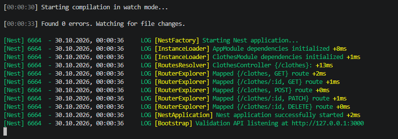
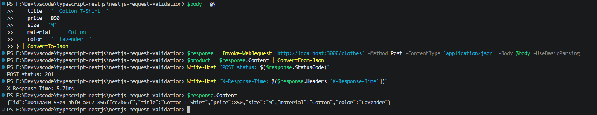
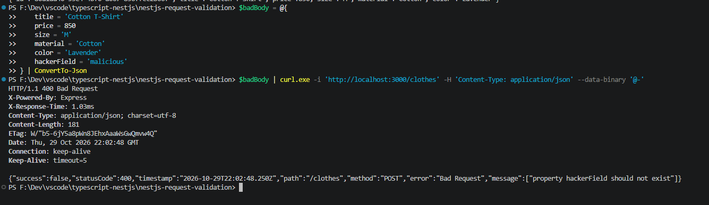
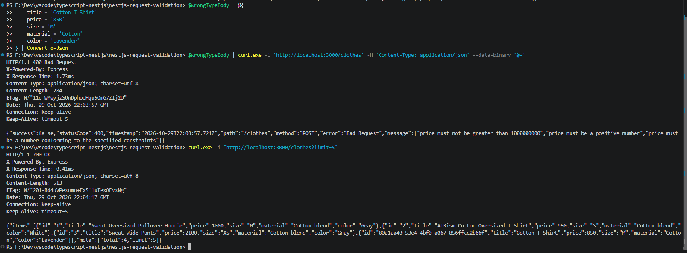
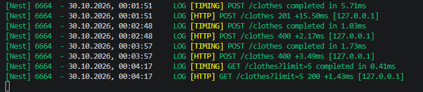
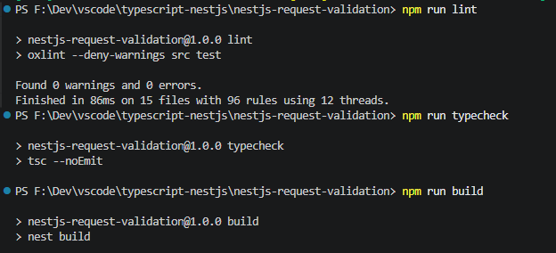
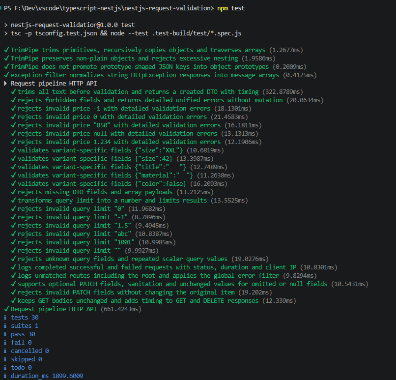

# Request Validation API

Практична робота № 6

Валідація вхідних даних та обробка запитів у NestJS

Реалізовано всі три рівні для варіанта 3 — каталог одягу `/clothes` із валідацією DTO, рекурсивним очищенням тексту, логуванням запитів, єдиним форматом HTTP-помилок і вимірюванням затримки

Застосунок повертає JSON, дані зберігаються в пам’яті процесу, вебінтерфейсу та бази даних немає

## Запуск

Потрібні Node.js версії 22 або новішої та npm, перевірено на Node.js 24

Перейти до папки проєкту, підставивши фактичне розташування

```powershell
cd ".../nestjs-request-validation"
npm ci
npm run start:dev
```

Сервер за замовчуванням слухає `127.0.0.1:3000`, у другому терміналі перевірити список

```powershell
curl.exe -i "http://localhost:3000/clothes?limit=5"
```

Для іншого порту задати змінну середовища перед запуском

```powershell
$env:PORT = '3001'
npm run start:dev
```

Адреса прив’язки налаштовується через `HOST`, порт має бути цілим числом від `1` до `65535`, зупинити сервер через Ctrl+C

Для запуску зібраного застосунку виконати

```powershell
npm run build
npm run start:prod
```

Після перезапуску відновлюються три початкові товари, попередні зміни не зберігаються, кореневий шлях `/` повертає 404, для перевірки API використовувати `/clothes`

## Конвеєр обробки запиту

1. `HttpLoggingMiddleware` запам’ятовує метод, URL, IP і початковий час, передає запит через `next()`
2. `TimingInterceptor` починає вимірювання перед пайпами та обробником
3. `TrimPipe` очищує текстові значення
4. `ValidationPipe` перетворює DTO та перевіряє його правила
5. Контролер делегує операцію сервісу каталогу
6. `TimingInterceptor` встановлює `X-Response-Time` перед надсиланням відповіді
7. При `HttpException` фільтр формує стандартизовану помилку
8. Після події `finish` middleware логує остаточний HTTP-статус і тривалість

Guards у цій роботі не додаються, оскільки завдання не передбачає автентифікацію або перевірку ролей, фільтр виключень виконується при помилках, успішні відповіді через нього не проходять

`main.ts` викликає `configureApplication`, де глобально реєструються пайпи, фільтр та інтерцептор, та сама конфігурація використовується HTTP-тестами

## Рівень 1 — DTO та ValidationPipe

Глобальний `ValidationPipe` налаштовано з `whitelist: true`, `forbidNonWhitelisted: true`, `transform: true`

`CreateClothesDto` — клас із перевірками кожного поля через `class-validator`

| Поле       | Правила                                                                     |
| ---------- | --------------------------------------------------------------------------- |
| `title`    | `IsString`, `IsNotEmpty`, до 120 символів                                   |
| `price`    | `IsNumber`, `IsPositive`, максимум 1 000 000 000, до двох десяткових знаків |
| `size`     | `IsEnum` зі значеннями `XS`, `S`, `M`, `L`, `XL`                            |
| `material` | `IsString`, `IsNotEmpty`, до 80 символів                                    |
| `color`    | `IsString`, `IsNotEmpty`, до 80 символів                                    |

Пробіли прибираються до валідації, тому рядок лише з пробілів відхиляється, нульова або від’ємна ціна теж не допускається

`UpdateClothesDto` створено через `PartialType(CreateClothesDto)`, який додає `IsOptional` для кожного поля та успадковує перевірки, непередані поля не змінюються

Відповідно до семантики `IsOptional`, значення `null` у PATCH пропускає перевірки та в сервісі обробляється як відсутнє поле, воно не записується замість обов’язкового значення, порожній PATCH `{}` повертає товар без змін

Спроба передати `hackerField` або власний `id` повертає 400, рядок `"850"` у тілі запиту не перетворюється на ціну автоматично — очікується JSON-число

## Рівень 2 — TrimPipe та middleware

`TrimPipe` реалізує `PipeTransform`, обрізає зовнішні пробіли в окремих рядках і рекурсивно проходить об’єкти та масиви, повертаючи нову структуру без зміни вхідних даних

Числа, булеві значення та `null` залишаються без змін, неплоскі об’єкти на кшталт `Date` не перетворюються на звичайні об’єкти, надмірна глибина вкладення відхиляється зі статусом 400

`HttpLoggingMiddleware` зареєстровано через `AppModule implements NestModule` і `configure(consumer)`, wildcard `{*path}` охоплює всі маршрути, включно з `/`, та відповідає синтаксису поточного Express

Після `response.once('finish', ...)` стандартний `Logger` із контекстом `HTTP` виводить метод, URL, остаточний статус, час у мілісекундах та IP клієнта

```text
[HTTP] POST /clothes 201 +6.20ms [127.0.0.1]
[HTTP] POST /clothes 400 +3.10ms [127.0.0.1]
```

Час у прикладах умовний, фактичні значення залежать від запуску, тіла запитів і заголовки авторизації не логуються

## Рівень 3 — Фільтр та інтерцептор

`GlobalExceptionFilter` із `@Catch(HttpException)` отримує Express-запит і відповідь через `switchToHttp`, зберігає HTTP-статус та уніфікує формат помилок валідації й відсутнього ресурсу

Наприклад, для рядка замість числової ціни відповідь має статус 400 та структуру

```json
{
  "success": false,
  "statusCode": 400,
  "timestamp": "2026-10-29T18:00:00.000Z",
  "path": "/clothes",
  "method": "POST",
  "error": "Bad Request",
  "message": [
    "price must be a number conforming to the specified constraints",
    "price must be a positive number"
  ]
}
```

Це приклад формату, timestamp і порядок повідомлень залежать від фактичного запиту, `message` завжди повертається як масив рядків, стек викликів у відповідь не додається

`TimingInterceptor` використовує `performance.now()` та RxJS `tap`, додає `X-Response-Time` на кшталт `3.82ms` і логує тривалість у контексті `TIMING`, тіло відповіді не змінюється

Заголовок присутній у всіх успішних відповідях маршрутів, включно з 204, також він додається при помилках, що проходять через інтерцептор, відсутній маршрут може повернути 404 до входу в інтерцептор

Вимірювання інтерцептора охоплює пайпи й виконання обробника, middleware вимірює час до завершення надсилання відповіді, тому їхні значення можуть відрізнятися

## Query-трансформація

`ListClothesQueryDto` описує опціональний `limit`, використовує `@Type(() => Number)`, `IsInt`, `Min(1)` і `Max(1000)`

Для `GET /clothes?limit=5` значення перетворюється на число до виклику сервісу, у відповіді `meta.limit` містить число `5`, без параметра використовується `10`

Список повертається у форматі `{ items, meta: { total, limit } }`, `total` показує кількість записів у сховищі до обмеження, невідомі query-поля й некоректні значення повертають 400

## Маршрути

| Метод і шлях           | Призначення                | Статуси          |
| ---------------------- | -------------------------- | ---------------- |
| `GET /clothes?limit=5` | Список і числове обмеження | 200 або 400      |
| `GET /clothes/:id`     | Один товар                 | 200 або 404      |
| `POST /clothes`        | Створення товару           | 201 або 400      |
| `PATCH /clothes/:id`   | Часткове оновлення         | 200, 400 або 404 |
| `DELETE /clothes/:id`  | Видалення без тіла         | 204 або 404      |

Початкові записи мають ID `1`, `2`, `3`, ціни та характеристики є навчальними даними

## Ручне тестування

Відкрити `requests.http` у VS Code з розширенням REST Client, залишивши сервер запущеним, виконувати запити через Send Request

| Послідовність                                                   | Очікуваний результат                           |
| --------------------------------------------------------------- | ---------------------------------------------- |
| POST із пробілами у назві, матеріалі та кольорі                 | 201, очищені рядки та `X-Response-Time`        |
| POST із `hackerField`                                           | 400 і `property hackerField should not exist`  |
| POST із рядковою ціною                                          | 400 та єдиний формат помилки                   |
| POST із від’ємною ціною                                         | 400 і повідомлення про додатну ціну            |
| GET із `limit=5`                                                | 200, числовий `meta.limit: 5`                  |
| GET із `limit=1`                                                | Один запис і загальна кількість у `meta.total` |
| GET із некоректним limit                                        | 400 у спільному форматі                        |
| POST із порожніми після очищення полями й недопустимим розміром | 400 з масивом порушень                         |
| GET відсутнього товару                                          | 404 у спільному форматі                        |
| PATCH створеного товару                                         | 200, оновлені поля та очищений колір           |
| DELETE створеного товару                                        | 204 без тіла відповіді                         |

Для PATCH і DELETE спочатку виконати іменований POST `createClothing`, його ID використовується в наступних запитах автоматично, при зміні порту оновити `@baseUrl` у файлі

У першому терміналі після кожного запиту перевірити логи `HTTP` і, для оброблених маршрутів, `TIMING`

## Перевірки коду

```powershell
npm run lint
npm run typecheck
npm run build
npm test
```

Лінтер, перевірка типів і збірка завершуються без помилок, успішно пройдено 30 тестів — `pass 30`, `fail 0`

## Структура

| Шлях                                              | Призначення                                                |
| ------------------------------------------------- | ---------------------------------------------------------- |
| `src/main.ts`                                     | Запуск HTTP-сервера та підключення глобальної конфігурації |
| `src/configure-application.ts`                    | Порядок глобальних пайпів, фільтр і інтерцептор            |
| `src/app.module.ts`                               | Імпорт каталогу та реєстрація middleware                   |
| `src/clothes/`                                    | Контролер, сервіс, модель і DTO каталогу                   |
| `src/common/pipes/trim.pipe.ts`                   | Рекурсивне очищення тексту                                 |
| `src/common/middleware/http-logger.middleware.ts` | HTTP-логи після завершення відповіді                       |
| `src/common/filters/http-exception.filter.ts`     | Єдиний формат HTTP-помилок                                 |
| `src/common/interceptors/timing.interceptor.ts`   | Заголовок часу й логи затримки                             |
| `test/pipeline.spec.ts`                           | Тести компонентів та реальних HTTP-запитів                 |
| `requests.http`                                   | Запити для ручної перевірки                                |

## Скріни

### 1 — Запуск застосунку

Компіляція в режимі розробки завершується з `Found 0 errors`, NestJS ініціалізує модулі й реєструє маршрути GET, POST, PATCH і DELETE для `/clothes`

Повідомлення `Validation API listening at http://127.0.0.1:3000` підтверджує готовність сервера приймати запити



### 2 — Валідний POST та очищення тексту

Запит містить пробіли на початку й у кінці назви, матеріалу та кольору, відповідь повертає очищені значення `Cotton T-Shirt`, `Cotton`, `Lavender`, що підтверджує роботу `TrimPipe` перед валідацією

Товар створено зі статусом `201`, заголовок `X-Response-Time: 5.71ms` додано інтерцептором, у відповіді присутній згенерований UUID



### 3 — Відхилення забороненого поля

POST-запит із зайвим `hackerField` повертає `400 Bad Request`, у масиві `message` міститься `property hackerField should not exist`

Фільтр формує єдину структуру з `success: false`, статусом, часовою міткою, шляхом, методом і описом помилки, заголовок `X-Response-Time` також присутній



### 4 — Некоректний тип ціни та query-трансформація

У першому запиті `price` передано як рядок `"850"`, валідація відхиляє його зі статусом `400`, фільтр повертає масив повідомлень про порушені правила ціни

Наступний `GET /clothes?limit=5` повертає `200` та `meta: { total: 4, limit: 5 }`, значення `limit` є JSON-числом, а список містить три початкові товари й один успішно створений, невдалі POST-запити нових записів не додали

Обидві відповіді мають заголовок часу, на скріні видно різницю між відхиленням рядкової ціни в JSON-тілі та явним перетворенням query-параметра на число



### 5 — Логи middleware та інтерцептора

Для валідного POST, двох відхилених POST і GET показано логи `TIMING` та `HTTP`, middleware фіксує остаточні статуси `201`, `400`, `400`, `200`, URL, тривалість і loopback IP клієнта

Значення `TIMING` відповідають заголовкам попередніх відповідей — `5.71ms`, `1.03ms`, `1.73ms`, `0.41ms`, тривалість у `HTTP` більша, оскільки вимірюється до події завершення відповіді



### 6 — Перевірка якості коду та збірка

Лінтер завершується з `0 warnings` і `0 errors`, команди `npm run typecheck` та `npm run build` також завершуються без помилок



### 7 — Автоматичні перевірки pipeline

Тести перевіряють рекурсивну санітизацію, незмінність вхідних даних, валідацію DTO, відхилення зайвих полів, query-трансформацію, єдиний формат помилок, фактичні HTTP-логи, заголовки часу та CRUD

Підсумок — `tests 30`, `pass 30`, `fail 0`, пропущених і скасованих тестів немає, згадки про 400 і некоректні дані в назвах успішних тестів означають перевірку очікуваного відхилення запитів


