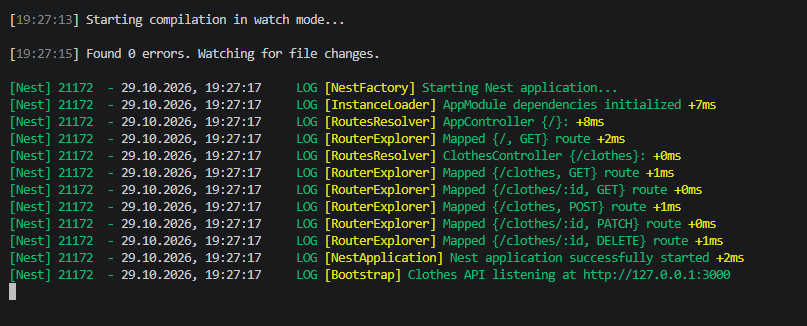
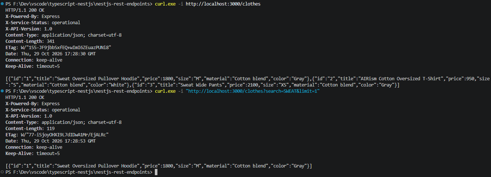
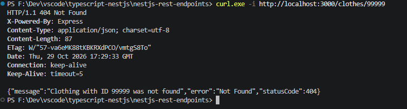
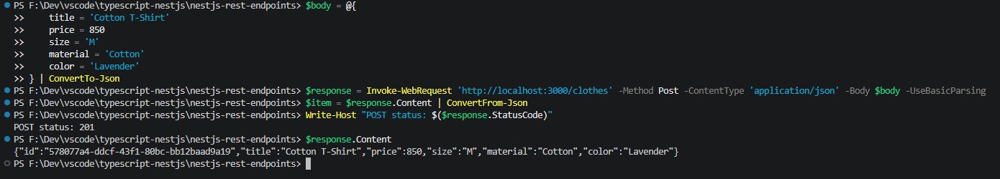
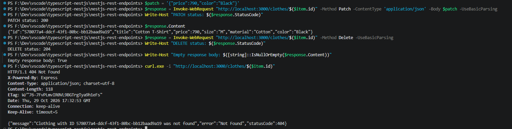
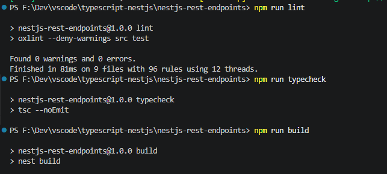
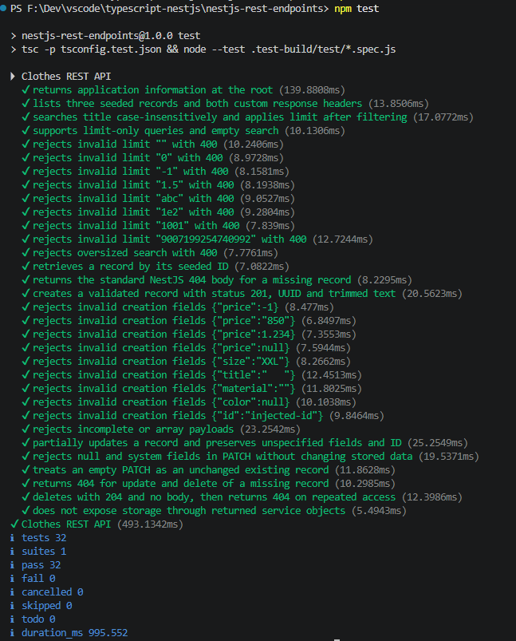

# Clothes REST API

Практична робота № 4

Розроблення REST-ендпоінтів засобами NestJS

Реалізовано всі три рівні для варіанта 3 — одяг та взуття, ресурс `/clothes`

API працює з моделлю одягу `Clothing`, використовує контролер, сервіс із dependency injection та приватне in-memory сховище, інтерфейсу вебсторінки немає, відповіді повертаються у JSON

## Запуск

Потрібні Node.js версії 22 або новішої та npm, перевірено на Node.js 24

Перейти до папки проєкту, підставивши фактичне розташування

```powershell
cd ".../nestjs-rest-endpoints"
```

Встановити залежності з lock-файлу та запустити режим розробки

```powershell
npm ci
npm run start:dev
```

Сервер за замовчуванням слухає `127.0.0.1:3000`, перевірити відповідь у другому терміналі або браузері

```powershell
curl.exe -i http://localhost:3000/
curl.exe -i http://localhost:3000/clothes
```

Зупинити сервер через Ctrl+C, повторний запуск відновлює три початкові товари, зміни не записуються у файли або базу даних

Для іншого порту перед запуском задати змінну середовища

```powershell
$env:PORT = '3001'
npm run start:dev
```

Адреса прив’язки налаштовується через `HOST`, порт має бути цілим числом від `1` до `65535`

Для звичайного запуску зібраного застосунку виконати

```powershell
npm run build
npm run start:prod
```

## Ресурс і маршрути

| Метод і шлях          | Результат                                        | HTTP-статус      |
| --------------------- | ------------------------------------------------ | ---------------- |
| `GET /`               | Коротка інформація про застосунок і ресурс       | 200              |
| `GET /clothes`        | Список товарів, необов’язкові `search` і `limit` | 200              |
| `GET /clothes/:id`    | Один товар за ідентифікатором                    | 200 або 404      |
| `POST /clothes`       | Створений товар із UUID                          | 201 або 400      |
| `PATCH /clothes/:id`  | Товар після часткового оновлення                 | 200, 400 або 404 |
| `DELETE /clothes/:id` | Видалення без тіла відповіді                     | 204 або 404      |

Метод `GET /clothes` повертає заголовки `X-API-Version: 1.0` і `X-Service-Status: operational`

Початкові товари мають ідентифікатори `1`, `2`, `3` та назви Sweat Oversized Pullover Hoodie, AIRism Cotton Oversized T-Shirt, Sweat Wide Pants, ціни й характеристики є навчальними даними

## DTO і валідація

`CreateClothesDto` — клас з обов’язковими полями `title`, `price`, `size`, `material`, `color`, `UpdateClothesDto` успадковує перевірки через `PartialType`, але дозволяє пропускати поля

| Поле       | Обмеження                                                           |
| ---------- | ------------------------------------------------------------------- |
| `title`    | Непорожній рядок до 120 символів після видалення зовнішніх пробілів |
| `price`    | JSON-число від 0 до 1 000 000 000, до двох десяткових знаків        |
| `size`     | `XS`, `S`, `M`, `L` або `XL`                                        |
| `material` | Непорожній рядок до 80 символів після видалення зовнішніх пробілів  |
| `color`    | Непорожній рядок до 80 символів після видалення зовнішніх пробілів  |

Глобальний `ValidationPipe` перевіряє DTO через `class-validator` і перетворює їх на екземпляри класів через `class-transformer`, зайві поля, зокрема переданий клієнтом `id`, відхиляються зі статусом `400`

У `PATCH` відсутні поля залишаються без змін, значення `null` відхиляються, порожній об’єкт `{}` повертає наявний товар без змін, первинний ключ залишається незмінним

Для відсутнього запису сервіс генерує `NotFoundException`, NestJS формує стандартну JSON-відповідь зі статусом `404`, наприклад

```json
{
  "message": "Clothing with ID 99999 was not found",
  "error": "Not Found",
  "statusCode": 404
}
```

## Пошук та обмеження видачі

`search` виконує пошук за підрядком у `title` без урахування регістру та прибирає зовнішні пробіли, порожній пошук не фільтрує список, максимальна довжина — 120 символів

`limit` обмежує кількість записів після фільтрації, допустимі цілі числа від `1` до `1000`, без параметра повертаються всі знайдені товари, некоректне значення повертає `400`

```powershell
curl.exe -i "http://localhost:3000/clothes?search=SWEAT"
curl.exe -i "http://localhost:3000/clothes?search=sweat&limit=1"
```

У початковому сховищі пошук `SWEAT` знаходить худі та штани, з `limit=1` повертається лише худі

## Перевірка через REST Client

Відкрити `requests.http` з розширенням REST Client, залишивши сервер запущеним, для кожного запиту натиснути Send Request

Файл містить запити до кореневого маршруту, списку, пошуку, пошуку з обмеженням, наявного й відсутнього товару, створення, читання, часткового оновлення та видалення, а також перевірки некоректної ціни, ліміту й спроби зміни `id`

Спочатку виконати іменований POST-запит `createClothing`, наступні запити автоматично використовують його ідентифікатор через `{{createClothing.response.body.$.id}}`, потім виконати GET, PATCH, DELETE і повторний GET у цьому порядку

При зміні порту оновити `@baseUrl` у верхньому рядку файлу, після перезапуску сервера повторно виконати POST, оскільки попередній товар існував лише в пам’яті

## Перевірка коду й HTTP-контрактів

```powershell
npm run lint
npm run typecheck
npm run build
npm test
```

Лінтер перевіряє код без автоматичних виправлень, `typecheck` перевіряє всі вихідні й тестові файли, `build` збирає застосунок у `dist`

Тести компілюються в `.test-build` та запускаються вбудованим тестовим засобом Node.js, для кожного тесту створюється окремий Nest-застосунок на випадковому loopback-порту, який закривається після перевірки, порт `3000` і дані запущеного вручну сервера не використовуються

Аудит залежностей виконання `npm audit --omit=dev` не виявив вразливостей, повний аудит повідомляє про три пов’язані попередження низької важливості в ланцюжку інструментів розробки Nest CLI → fork-ts-checker-webpack-plugin → deepmerge, вони не входять до залежностей виконання API

| Перевірка                                                    | Результат                             |
| ------------------------------------------------------------ | ------------------------------------- |
| Початковий список, пошук, `limit`, обидва заголовки          | 200 і відповідні дані                 |
| Читання неіснуючого товару                                   | 404 зі стандартним тілом NestJS       |
| Створення валідного товару                                   | 201, UUID, очищені текстові поля      |
| Некоректні або зайві поля, `null`, відсутні обов’язкові поля | 400 без зміни сховища                 |
| Часткове оновлення                                           | 200, збережені `id` і непередані поля |
| Видалення товару                                             | 204 і порожнє тіло                    |
| Читання, оновлення й повторне видалення відсутнього товару   | 404                                   |
| Зміна об’єкта, повернутого сервісом                          | Сховище залишається незмінним         |

`dist`, `.test-build`, `node_modules`, локальні змінні середовища та кеші редакторів виключені через `.gitignore`, вихідний код, `package-lock.json`, `requests.http` і скріншоти призначені для публікації

## Структура та виконання рівнів

Проєкт, контролер і сервіс створено командами Nest CLI, `ClothesController` зареєстровано в `AppModule.controllers`, `ClothesService` — в `AppModule.providers`

| Шлях                                | Призначення                                                    |
| ----------------------------------- | -------------------------------------------------------------- |
| `src/main.ts`                       | Створення застосунку, перевірка конфігурації та запуск сервера |
| `src/app.module.ts`                 | Реєстрація контролерів, сервісу та глобальної валідації        |
| `src/app.controller.ts`             | Перевірка доступності застосунку через `GET /`                 |
| `src/clothes/clothes.controller.ts` | Маршрути, HTTP-статуси, параметри запиту й заголовки           |
| `src/clothes/clothes.service.ts`    | In-memory сховище, бізнес-операції та винятки                  |
| `src/clothes/clothing.entity.ts`    | Модель ресурсу та допустимі розміри                            |
| `src/clothes/dto/`                  | Контракти створення й часткового оновлення з перевірками       |
| `test/clothes.spec.ts`              | HTTP-тести та перевірка ізоляції даних                         |
| `requests.http`                     | Запити для ручної перевірки API                                |

Рівень 1 охоплює ініціалізацію через CLI, DTO та GET/POST, рівень 2 — сервіс, DI, повний CRUD, статуси й винятки, рівень 3 — `search`, `limit`, кастомні заголовки та HTTP-запити для перевірки

Підходи до [валідації](https://docs.nestjs.com/techniques/validation) та [контролерів](https://docs.nestjs.com/controllers) відповідають офіційній документації NestJS

## Скріншоти

### 1 — Запуск сервера та реєстрація маршрутів

Показано запуск у режимі розробки, повідомлення `Found 0 errors`, ініціалізацію залежностей `AppModule` та реєстрацію маршрутів GET, POST, PATCH і DELETE для `/clothes`

Повідомлення `Clothes API listening at http://127.0.0.1:3000` підтверджує адресу запущеного сервера



### 2 — Список товарів, пошук і обмеження видачі

Запит `GET /clothes` повертає `200 OK` та три початкові товари, у відповіді присутні обидва задані заголовки — `X-API-Version: 1.0` і `X-Service-Status: operational`

Другий запит `GET /clothes?search=SWEAT&limit=1` демонструє пошук без урахування регістру та обмеження результату одним товаром



### 3 — Обробка відсутнього товару

Запит `GET /clothes/99999` повертає `404 Not Found`, тіло містить повідомлення `Clothing with ID 99999 was not found`, поле `error: "Not Found"` та `statusCode: 404`

Це очікувана відповідь на запит неіснуючого ресурсу, сформована NestJS після `NotFoundException` у сервісі



### 4 — Створення товару через POST

У PowerShell сформовано JSON із полями `title`, `price`, `size`, `material`, `color` та надіслано POST-запит до `/clothes`

Відповідь має статус `201`, новий товар Cotton T-Shirt отримав UUID, ціну `850`, розмір `M`, матеріал `Cotton` і колір `Lavender`



### 5 — Часткове оновлення та видалення

PATCH-запит до створеного товару змінює лише ціну на `790` та колір на `Black`, відповідь має статус `200`, ідентифікатор, назва, розмір і матеріал залишаються без змін

DELETE повертає `204`, перевірка `Empty response body: True` підтверджує відсутність тіла відповіді, наступний GET за тим самим UUID повертає `404`, оскільки товар видалено зі сховища



### 6 — Лінтер, перевірка типів і збірка

Команда `npm run lint` завершується з `0 warnings` і `0 errors`, після `npm run typecheck` та `npm run build` керування повертається до терміналу без діагностик помилок



### 7 — Автоматичні HTTP-тести

Показано виконання `npm test`, тестовий набір перевіряє CRUD, пошук, обмеження видачі, заголовки, валідацію DTO, захист ідентифікатора, стандартні відповіді 404 та порожнє тіло при видаленні

Підсумок — `tests 32`, `pass 32`, `fail 0`, пропущених і скасованих тестів немає, згадки про 400 і 404 у назвах успішних тестів означають перевірку очікуваних відповідей на некоректні запити


