# CRUD одягу з TypeORM та PostgreSQL

Практична робота №7, варіант 3 — одяг та взуття

Реалізовано всі три рівні: PostgreSQL у Docker Compose, персистентний REST CRUD через TypeORM, пагінацію, пошук, сортування, м’яке видалення та відновлення товарів

## Запуск

Потрібні Node.js 22.13+ або новіша LTS-версія, npm і запущений Docker Desktop з Docker Compose V2

Перейти до каталогу проєкту

```powershell
cd ...\nestjs-typeorm-postgresql-crud
```

Для першого запуску після клонування скопіювати приклад конфігурації

```powershell
Copy-Item .env.example .env
```

У `.env` замінити значення `POSTGRES_PASSWORD` власним локальним паролем, встановити залежності та запустити PostgreSQL

```powershell
npm ci
docker compose up -d --wait
docker compose ps
npm run start:dev
```

Якщо локальний `.env` уже налаштовано, повторно копіювати приклад не потрібно

API доступний за адресою `http://localhost:3000/clothes`, PostgreSQL — на `127.0.0.1:5432`

Параметри підключення задаються через `.env`: `POSTGRES_USER`, `POSTGRES_PASSWORD`, `POSTGRES_DB`, `DB_HOST`, `DB_PORT`, `HOST`, `PORT`, `DB_LOG_SQL`

Файл `.env` виключено з Git, у репозиторії зберігається лише `.env.example` без реального пароля

Після першої ініціалізації PostgreSQL зміна пароля у `.env` сама по собі не змінює пароль користувача в наявній базі

Для перегляду DDL та SQL-запитів використати `DB_LOG_SQL=true`, для вимкнення звичайних SQL-логів — `false`

`synchronize: true` та `autoLoadEntities: true` увімкнено відповідно до завдання, схема створюється автоматично під час запуску NestJS

Цей режим призначений для локальної розробки, запуск із `NODE_ENV=production` заблоковано, для виробничого середовища потрібні міграції та вимкнена автоматична синхронізація

Зупинити NestJS через `Ctrl+C`, зупинити PostgreSQL зі збереженням даних

```powershell
docker compose down
```

Іменований том `pgdata` зберігає дані між перезапусками та повторним створенням контейнера, параметр `down -v` видаляє цей том разом із даними

## Реалізація

`AppModule` налаштовує `TypeOrmModule.forRoot()`, `ClothesModule` реєструє сутність через `TypeOrmModule.forFeature([ClothingEntity])`, а `ClothesService` отримує типізований `Repository<ClothingEntity>` через `@InjectRepository()`

Контролер приймає HTTP-запити та делегує операції сервісу, дані зберігаються в PostgreSQL, in-memory сховище відсутнє

### Таблиця `clothes`

| Поле        | Тип PostgreSQL                       | Призначення                             |
| ----------- | ------------------------------------ | --------------------------------------- |
| `id`        | `uuid`                               | Автоматично згенерований первинний ключ |
| `title`     | `varchar(150)`                       | Назва товару                            |
| `price`     | `decimal(10,2)`                      | Вартість, більша за нуль                |
| `size`      | `enum('XS','S','M','L','XL')`        | Розмір за варіантом 3                   |
| `material`  | `varchar(80)`                        | Матеріал                                |
| `color`     | `varchar(50)`                        | Колір                                   |
| `createdAt` | `timestamp with time zone`           | Автоматична дата створення              |
| `updatedAt` | `timestamp with time zone`           | Автоматична дата оновлення              |
| `deletedAt` | `timestamp with time zone`, nullable | Дата м’якого видалення                  |

У POST та PATCH ціна передається числом з максимум двома десятковими знаками, у відповіді повертається рядком на зразок `"850.00"`, щоб зберігати точне представлення PostgreSQL `decimal`

Глобальний `ValidationPipe` перевіряє DTO, відхиляє невідомі поля та перетворює параметри пагінації на числа, текстові поля очищуються від крайніх пробілів

Ідентифікатори перевіряються як UUID v4, некоректні дані повертають `400`, відсутній або видалений товар — `404`

### Ендпоінти

| Метод  | Маршрут                | Результат                                 |
| ------ | ---------------------- | ----------------------------------------- |
| GET    | `/clothes`             | `200`, сторінка активних товарів          |
| GET    | `/clothes/:id`         | `200`, один товар                         |
| POST   | `/clothes`             | `201`, створений товар                    |
| PATCH  | `/clothes/:id`         | `200`, частково оновлений товар           |
| DELETE | `/clothes/:id`         | `204`, м’яке видалення без тіла відповіді |
| PATCH  | `/clothes/:id/restore` | `200`, відновлений товар                  |

Повторне відновлення активного товару повертає його поточний стан, відновлення невідомого UUID повертає `404`

### Пагінація, пошук і сортування

| Параметр | Значення за замовчуванням | Допустимі значення                                      |
| -------- | ------------------------- | ------------------------------------------------------- |
| `page`   | `1`                       | Ціле число від 1 до 1 000 000                           |
| `limit`  | `10`                      | Ціле число від 1 до 100                                 |
| `search` | Без фільтра               | Підрядок назви до 150 символів, без урахування регістру |
| `sortBy` | `createdAt`               | `createdAt`, `title`, `price`                           |
| `order`  | `DESC`                    | `ASC`, `DESC`                                           |

Приклад запиту

```http
GET http://localhost:3000/clothes?page=1&limit=3&search=sweat&sortBy=price&order=ASC
```

Вибірка використовує `findAndCount()`, `skip = (page - 1) * limit` та `take = limit`, а пошук — `ILike`, значення пошуку передається параметром, символи `%` та `_` трактуються як звичайні символи

За однакових значень основного поля порядок уточнюється за `id`, ціна сортується в базі як число

Структура відповіді для семи товарів і першої сторінки розміром три записи

```json
{
  "data": [],
  "meta": {
    "total": 7,
    "page": 1,
    "limit": 3,
    "totalPages": 3
  }
}
```

У прикладі `data` скорочено до порожнього масиву, фактична перша сторінка містить три товари, `total` враховує пошук та виключає м’яко видалені записи

## Перевірка роботи

У `requests.http` підготовлено сім POST-запитів із тестовими товарами, отримання сторінок, пошук, сортування, CRUD, видалення та відновлення

Відкрити файл у VS Code з розширенням REST Client, виконати POST-запити послідовно через `Send Request`, далі виконати перевірочні запити

Перший POST має назву `createClothing`, наступні запити використовують UUID з його відповіді, повторне виконання POST створює додатковий запис

При першому запуску з новим томом каталог порожній, тестові товари не додаються автоматично

Для перевірки пагінації створено сім демонстраційних товарів, потім через POST додано восьмий товар `Cotton T-Shirt`, його оновлено, м’яко видалено та відновлено

На скрінах пагінації каталог містить сім товарів, після створення та відновлення додаткового товару — вісім, ці локальні дані не входять до репозиторію

Виконані перевірки

| Перевірка                           | Результат                                                                                      |
| ----------------------------------- | ---------------------------------------------------------------------------------------------- |
| PostgreSQL 16 у Docker Compose      | Контейнер має стан `healthy`, схема створена TypeORM                                           |
| Створення та читання                | Запис отримує UUID, точну ціну та часові мітки                                                 |
| Часткове оновлення                  | Змінюються лише передані поля, `id` і `createdAt` зберігаються                                 |
| Пагінація семи товарів із `limit=3` | Сторінки містять 3, 3 і 1 запис, `totalPages=3`                                                |
| Пошук і сортування                  | Пошук без урахування регістру, числове сортування ціни                                         |
| М’яке видалення                     | Рядок залишається в БД з `deletedAt`, у звичайній видачі відсутній                             |
| Відновлення                         | Повертається той самий UUID, `deletedAt` стає `null`                                           |
| Повний перезапуск процесу NestJS    | Усі вісім товарів збереглися, доданий товар має той самий UUID, ціну `790.00` та колір `Black` |

Для самостійної перевірки персистентності отримати каталог, зупинити NestJS через `Ctrl+C`, повторно виконати `npm run start:dev` і порівняти UUID та значення товарів у відповіді GET

### Автоматичні перевірки

За запущеного PostgreSQL виконати

```powershell
npm run lint
npm run typecheck
npm run build
npm test
```

Перевірка стилю, типів і збірка завершилися успішно, усі 23 тести пройшли

Тести працюють зі справжнім PostgreSQL в окремій тимчасовій схемі, створюють її перед запуском і видаляють після завершення, дані каталогу в `public` не очищуються

Перевіряються SQL-типи колонок, enum, UUID, точність ціни, CRUD, аудит, пагінація, пошук, сортування, видалення, відновлення, повторний запуск застосунку та помилки валідації

## Скріни виконання

### 1 — PostgreSQL у Docker Compose

Запущений Compose-проєкт `nestjs-typeorm-postgresql-crud` містить контейнер `postgres-1` з образом `postgres:16-alpine` та опублікованим портом `5432:5432`

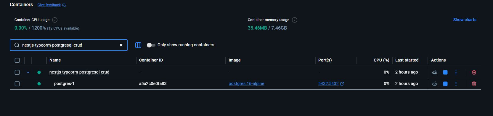

### 2 — Готовність PostgreSQL

Журнал містить створення бази та повідомлення `database system is ready to accept connections`, зупинка проміжного сервера під час початкової ініціалізації завершується запуском основного процесу PostgreSQL

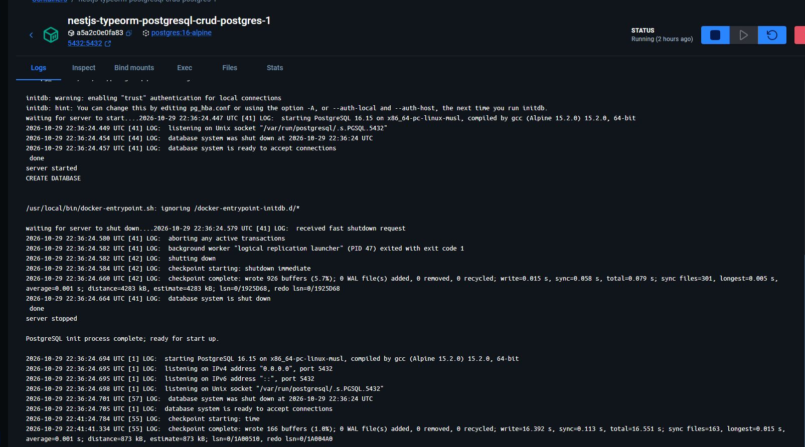

### 3 — Постійне зберігання даних

Іменований том `nestjs-typeorm-postgresql-crud_pgdata` використовується контейнером PostgreSQL і підключений до `/var/lib/postgresql/data`

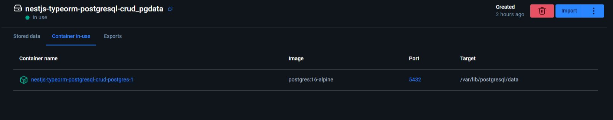

### 4 — Запуск NestJS та TypeORM

TypeORM підключається до PostgreSQL та перевіряє наявну таблицю `clothes` і тип розміру `clothing_size`, транзакція завершується через `COMMIT`, після чого NestJS реєструє CRUD-маршрути та маршрут відновлення й успішно запускає API

На цьому кадрі показано перевірку вже створеної схеми під час повторного запуску, тому повторного `CREATE TABLE` немає

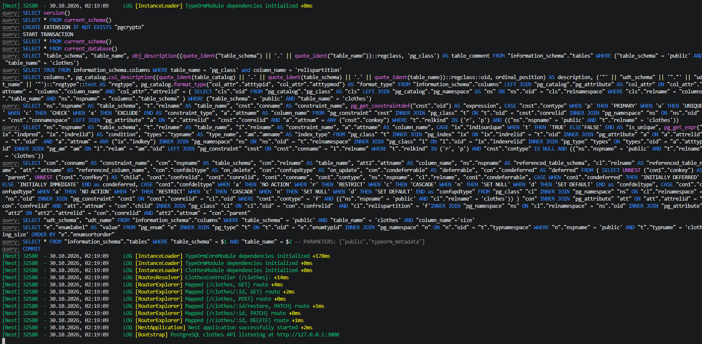

### 5 — Offset-based пагінація

Запити `page=1&limit=3` та `page=2&limit=3` повертають різні трійки товарів, метадані обох відповідей містять `total=7`, `limit=3`, `totalPages=3` та відповідний номер сторінки

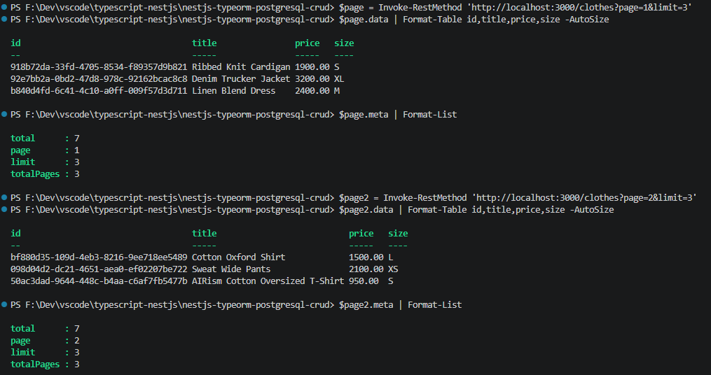

### 6 — Пошук і сортування

Запит `search=SWEAT&sortBy=price&order=ASC` знаходить два товари незалежно від регістру пошукового рядка та повертає їх за зростанням ціни: `1650.00`, потім `2100.00`, метадані враховують лише знайдені товари

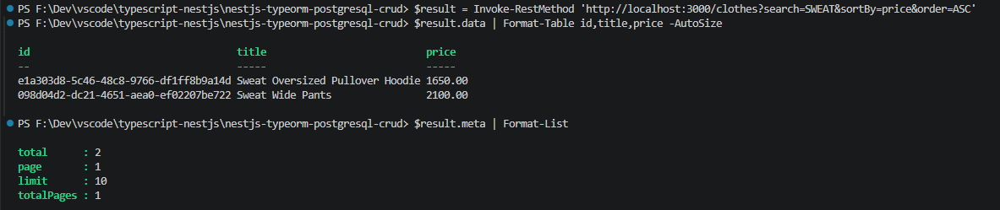

### 7 — Створення товару

POST створює `Cotton T-Shirt` і повертає `201 Created`, згенерований UUID, ціну `850.00`, часові мітки `createdAt` і `updatedAt` та порожній `deletedAt`

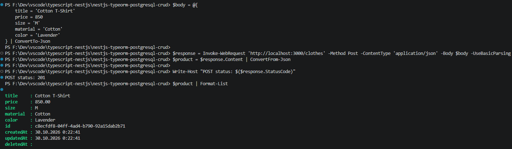

### 8 — Часткове оновлення

PATCH змінює лише ціну на `790.00` та колір на `Black`, повертає `200 OK` і актуалізує `updatedAt`, перевірки `Same ID` та `Same createdAt` повертають `True`

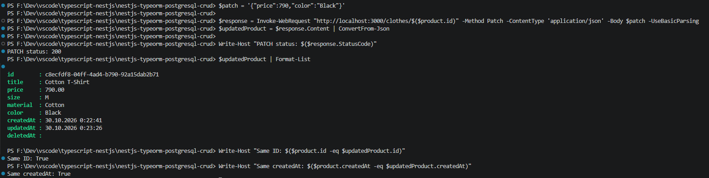

### 9 — М’яке видалення

DELETE повертає `204 No Content` із порожнім тілом, товар відсутній у каталозі, загальна кількість зменшується до семи, а GET за його UUID повертає `404 Not Found`

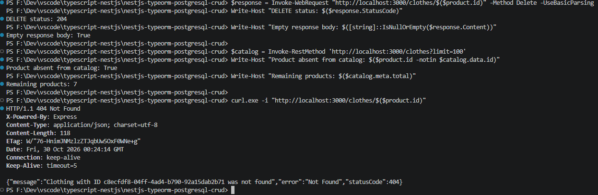

### 10 — Відновлення

PATCH на `/:id/restore` повертає `200 OK` та той самий UUID, зберігає оновлені ціну й колір та очищує `deletedAt`, товар знову присутній у каталозі, загальна кількість становить вісім

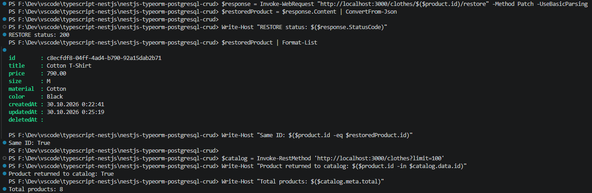

### 11 — Збереження після перезапуску

Після зупинки та повторного запуску процесу NestJS GET повертає раніше створений товар, усі перевірки збереження UUID, ціни `790.00` та кольору `Black` повертають `True`, у каталозі залишаються вісім товарів

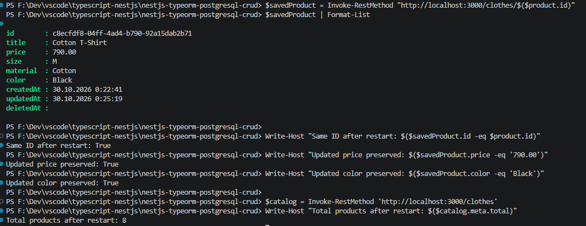

### 12 — Перевірка якості та збірка

`npm run lint` завершується без попереджень і помилок, `npm run typecheck` та `npm run build` виконуються успішно

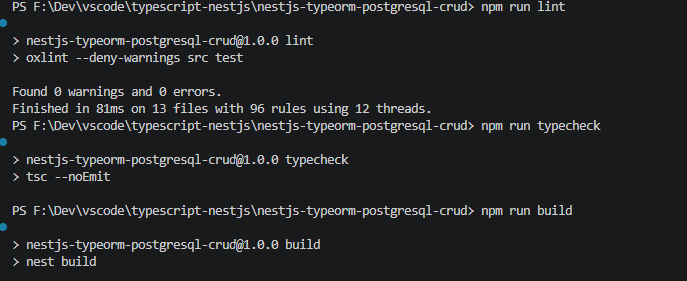

### 13 — Автоматичні тести PostgreSQL API

Усі 23 тести пройшли, `fail=0`, перевірено точні SQL-типи, CRUD, пагінацію, пошук, сортування, м’яке видалення, відновлення, персистентність та відхилення некоректних запитів

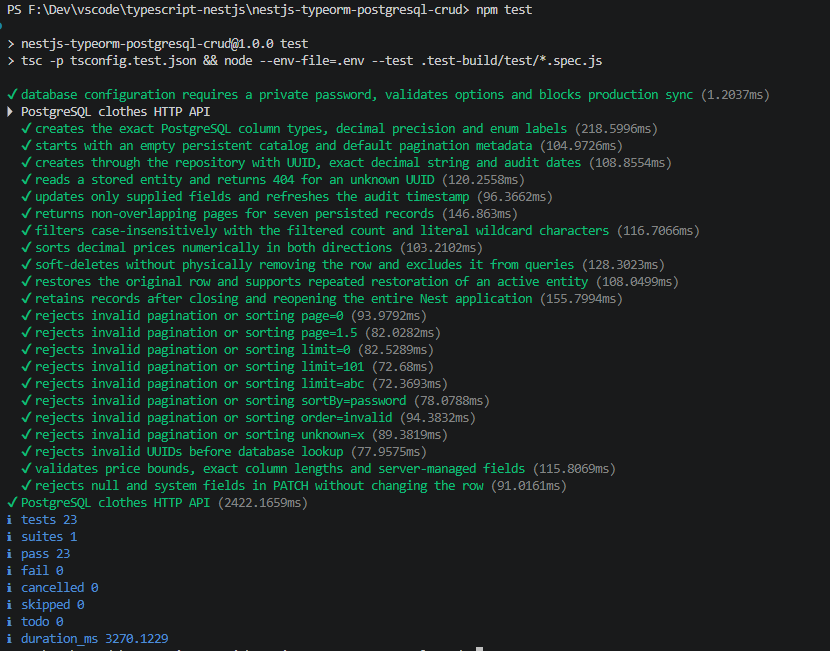
