# Зв’язки сутностей і міграції TypeORM

Практична робота №8, варіант 3 — одяг

Реалізовано всі три рівні: зв’язки колекцій, матеріалів і догляду за одягом, керування схемою PostgreSQL через міграції, вибірки QueryBuilder та атомарні операції створення й оновлення

## Запуск

Потрібні Node.js 22.13+ або новіша LTS-версія, npm і запущений Docker Desktop із Docker Compose V2

Перейти до каталогу проєкту

```powershell
cd ...\nestjs-typeorm-relations-migrations
```

Для першого запуску після клонування скопіювати конфігурацію

```powershell
Copy-Item .env.example .env
```

У `.env` замінити `POSTGRES_PASSWORD` власним локальним паролем, встановити залежності, запустити PostgreSQL та застосувати міграції

```powershell
npm ci
docker compose up -d --wait
docker compose ps
npm run migration:run
npm run migration:show
npm run start:dev
```

Якщо `.env` уже налаштовано, повторно копіювати приклад не потрібно

API працює за адресою `http://localhost:3001`, PostgreSQL доступний на `127.0.0.1:5433`, порти відрізняються від попередньої роботи, база та іменований том окремі

Параметри підключення і запуску задаються через `.env`: `POSTGRES_USER`, `POSTGRES_PASSWORD`, `POSTGRES_DB`, `DB_HOST`, `DB_PORT`, `HOST`, `PORT`, `DB_LOG_SQL`

`DB_LOG_SQL=true` вмикає SQL-логи застосунку, за замовчуванням використовується `false`, TypeORM CLI показує запити міграцій окремо

Локальний `.env` виключено з Git, у репозиторії зберігається `.env.example` без справжнього пароля

Зупинити API через `Ctrl+C`, зупинити PostgreSQL зі збереженням даних

```powershell
docker compose down
```

Дані зберігаються в іменованому томі `pgdata`, команда `docker compose down -v` видаляє його разом із базою

## Модель даних

| Сутність                | Таблиця             | Основні поля                                                                               |
| ----------------------- | ------------------- | ------------------------------------------------------------------------------------------ |
| `CollectionEntity`      | `collections`       | UUID, унікальна назва сезонної колекції                                                    |
| `ClothingEntity`        | `clothes`           | UUID, назва, ціна `decimal(10,2)`, розмір `XS/S/M/L/XL`, колір, дати створення й оновлення |
| `MaterialEntity`        | `materials`         | UUID, унікальна назва матеріалу                                                            |
| `CareInstructionEntity` | `care_instructions` | UUID, температура прання, ознака лише хімчистки, текст інструкції                          |

| Зв’язок               | Реалізація                    | Зовнішні ключі                                                     |
| --------------------- | ----------------------------- | ------------------------------------------------------------------ |
| Колекція → одяг, 1:M  | `@OneToMany` та `@ManyToOne`  | `clothes.collection_id`                                            |
| Одяг ↔ матеріали, M:N | `@ManyToMany` та `@JoinTable` | `clothing_materials.clothing_id`, `clothing_materials.material_id` |
| Одяг ↔ догляд, 1:1    | `@OneToOne` та `@JoinColumn`  | Унікальний `care_instructions.clothing_id`                         |

Кожен товар належить наявній колекції, має один або кілька матеріалів і одну інструкцію догляду, склад тканини представлено зв’язаними сутностями замість одного текстового поля

У POST і PATCH ціна передається числом, у відповідях повертається точним десятковим рядком, наприклад `"1800.00"`

Глобальний `ValidationPipe` перевіряє DTO, вкладений об’єкт догляду та масив матеріалів, відхиляє зайві поля й некоректні типи, очищує крайні пробіли через трансформації DTO

## Міграції

У конфігурації застосунку та CLI встановлено `synchronize: false` і `migrationsRun: false`, запуск API не змінює схему, міграції виконуються явно

`src/database/data-source.ts` налаштовує DataSource для CLI, спільна конфігурація підключення й сутностей міститься в `database.config.ts`, історія виконання зберігається в `schema_migrations`

Міграції згенеровано через CLI послідовно, після додавання відповідних сутностей

| Міграція                                   | Зміни                                                      |
| ------------------------------------------ | ---------------------------------------------------------- |
| `CreateCollectionsAndClothes1793321012890` | Таблиці колекцій та одягу, enum розмірів, зв’язок M:1      |
| `AddMaterials1793321049672`                | Матеріали, проміжна таблиця M:N, індекси та зовнішні ключі |
| `AddCareInstructions1793321100412`         | Таблиця догляду, унікальний зовнішній ключ зв’язку 1:1     |

Після зміни сутностей згенерувати нову міграцію

```powershell
npm run migration:generate -- src/database/migrations/DescribeSchemaChange
```

Переглянути згенеровані методи `up()` і `down()`, застосувати зміни та перевірити стан

```powershell
npm run migration:run
npm run migration:show
npm run typeorm -- schema:log
```

Для наявних трьох міграцій повторна генерація не потрібна, `migration:show` позначає виконані міграції через `[X]`, `schema:log` показує відсутність розбіжностей між схемою та сутностями

Перевірити відкат останньої міграції та її повторне виконання в навчальній базі без потрібних даних, попередньо зупинивши API

```powershell
npm run migration:revert
npm run migration:show
npm run migration:run
```

Відкат виконує `down()` останньої міграції, для `AddCareInstructions` це видалення таблиці догляду разом із її даними, повторне застосування відновлює схему, але не видалені записи

Під час реалізації також перевірено відкат `AddMaterials`: таблиці матеріалів і зв’язків зникли, таблиця одягу залишилася, повторне виконання міграції відновило структуру

CLI працює зі скомпільованим DataSource, скрипти генерації, запуску, відкату та перегляду стану самостійно виконують збірку перед викликом TypeORM

## API

| Метод  | Маршрут                  | Призначення                                              |
| ------ | ------------------------ | -------------------------------------------------------- |
| POST   | `/collections`           | Створити колекцію, `201`                                 |
| GET    | `/collections`           | Отримати колекції                                        |
| DELETE | `/collections/:id`       | Видалити колекцію з її одягом, `204`                     |
| POST   | `/clothes`               | Атомарно створити одяг, матеріали та догляд, `201`       |
| POST   | `/clothes/transactional` | Створити агрегат або продемонструвати rollback           |
| GET    | `/clothes`               | Отримати агрегати з фільтрацією та пагінацією            |
| GET    | `/clothes/:id`           | Отримати товар із вкладеними зв’язками через `relations` |
| GET    | `/clothes/:id/aggregate` | Отримати повний агрегат через QueryBuilder               |
| PATCH  | `/clothes/:id`           | Атомарно оновити передані поля та зв’язки                |
| DELETE | `/clothes/:id`           | Фізично видалити товар і залежні записи, `204`           |
| GET    | `/materials`             | Отримати довідник матеріалів                             |

Невідомий UUID повертає `404`, некоректні дані — `400`, конфлікт унікальної назви — `409`

### Створення агрегата

Спочатку створити колекцію, потім підставити її UUID у `collectionId`

```json
{
  "title": "Sweat Oversized Pullover Hoodie",
  "price": 1800,
  "size": "M",
  "color": "Gray",
  "collectionId": "UUID-of-existing-collection",
  "materials": ["Cotton", "Polyester"],
  "careInstruction": {
    "washingTemperature": 30,
    "dryCleanOnly": false,
    "instructions": "Wash inside out and air dry"
  }
}
```

У відповіді повертаються вкладені `collection`, `materials` та `careInstruction`, нові матеріали зберігаються каскадно, наявні повторно використовуються за точною назвою без створення дублікатів

PATCH дозволяє передавати лише змінені поля, масив `materials` замінює набір зв’язків товару, вкладений `careInstruction`, якщо передано, має містити всі три поля догляду

### QueryBuilder

Підтримуються `collectionId`, `material`, `materialId`, `search`, `page` та `limit`, фільтри можна комбінувати

```http
GET http://localhost:3001/clothes?material=COTTON
GET http://localhost:3001/clothes?collectionId=<uuid>&material=Polyester
GET http://localhost:3001/clothes?materialId=<uuid>&search=hoodie&page=1&limit=2
```

Назва матеріалу порівнюється без урахування регістру, `search` шукає підрядок назви одягу, значення передаються параметризовано

`innerJoinAndSelect()` завантажує колекцію та матеріали, `leftJoinAndSelect()` — догляд, окремий join для фільтра матеріалу дозволяє залишити у відповіді весь склад тканини

Пагінація використовує `skip`, `take` і `getManyAndCount()`, за замовчуванням `page=1`, `limit=10`, максимальний `limit=100`, відповідь має поля `data` та `meta: { total, page, limit, totalPages }`

### Транзакція та rollback

Обидва POST-маршрути створюють агрегат через `DataSource.transaction()`, усі операції використовують переданий транзакційний `EntityManager`

Спочатку перевіряється колекція та зберігається товар разом із матеріалами й таблицею зв’язків, потім додається догляд, успішний результат фіксується разом

Для демонстрації надіслано валідний запит на `/clothes/transactional` із додатковим полем `"simulateFailure": true`, помилка виникає всередині транзакції після збереження одягу та матеріалів, а не на етапі перевірки DTO

Сервер повертає `400` з повідомленням про rollback, товар, новий матеріал і проміжні зв’язки не залишаються в базі, попередні дані зберігаються

### Каскадні операції

Для M:N увімкнено `cascade: true`, але API формує об’єкти матеріалів самостійно з перевірених назв, клієнт не передає довільні сутності

Для догляду налаштовано каскадне збереження та оновлення, зовнішні ключі використовують `onDelete: 'CASCADE'`

Видалення товару прибирає його догляд і рядки `clothing_materials`, видалення колекції додатково прибирає весь її одяг, спільні матеріали залишаються в довіднику для інших товарів

Видалення виконується через `Repository.delete()`, тому каскад `remove` ORM не видаляє завантажені спільні матеріали, залежні рядки прибирає PostgreSQL через зовнішні ключі

## Перевірка

У `requests.http` підготовлено послідовність створення колекції й двох товарів, перевірки трьох зв’язків, фільтрації, пагінації, rollback, оновлення та каскадного видалення

Відкрити файл у VS Code з REST Client і виконувати запити через `Send Request`, іменовані запити автоматично передають UUID у наступні запити, повторне створення тієї самої назви колекції повертає `409`

За запущеного PostgreSQL виконати перевірки

```powershell
npm run lint
npm run typecheck
npm run build
npm test
```

Перевірка стилю, типів і збірка завершилися успішно, усі 31 автоматичний тест пройшли, падінь немає

Тести використовують окрему тимчасову базу `test_relations_<uuid>`, застосовують справжні згенеровані міграції, перевіряють їхній відкат і повторний запуск, дані основної бази `relations_db` не очищуються

Для створення та видалення тестової бази потрібне відповідне право користувача PostgreSQL, локальний користувач контейнера має його

Перевіряються всі типи зв’язків, повторне використання матеріалів, унікальність 1:1, атомарне оновлення, реальний rollback із підрахунком рядків у чотирьох таблицях, каскадне видалення, валідація та збереження агрегата після перезапуску

Додатково виконано HTTP-перевірку готового сервера та SQL-порівняння кількості рядків до і після rollback, автоматичного наповнення каталогу немає

## Скріни виконання

### 1 — PostgreSQL у Docker

Запущений Compose-проєкт містить контейнер `postgres:16-alpine` з опублікованим портом `5433:5432`

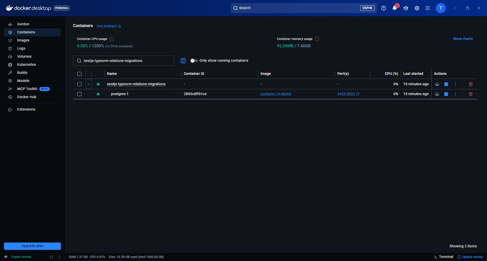

### 2 — Стан контейнера та історія міграцій

`docker compose ps` показує стан `healthy`, `migration:show` позначає всі три застосовані міграції через `[X]`

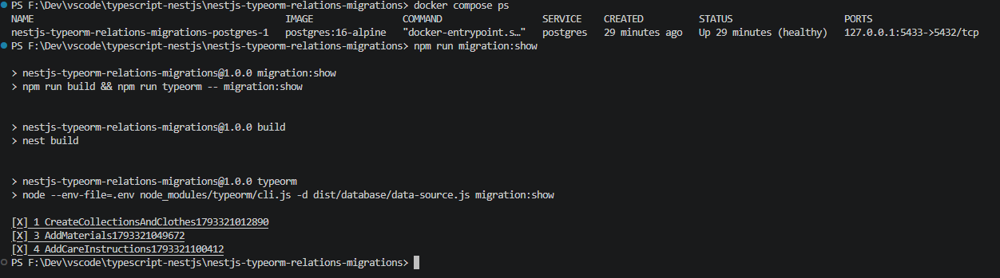

### 3 — Відкат останньої міграції

`migration:revert` виконує `down()` міграції `AddCareInstructions`, видаляє таблицю догляду та її зовнішній ключ, після `COMMIT` міграція позначена як незастосована через `[ ]`

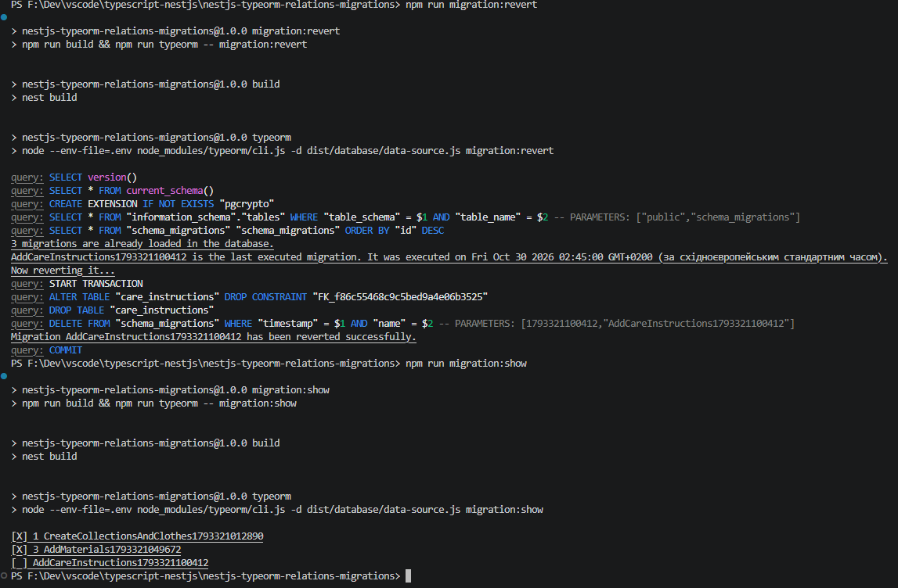

### 4 — Повторне застосування та відповідність схеми

`migration:run` повторно створює таблицю `care_instructions`, унікальність зв’язку 1:1 та зовнішній ключ з `ON DELETE CASCADE`, `schema:log` підтверджує відсутність розбіжностей між схемою та сутностями

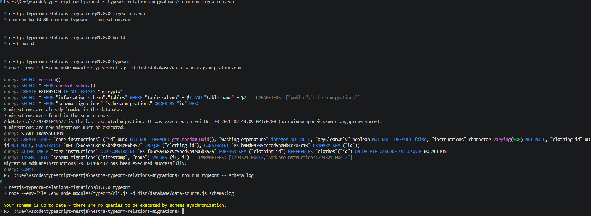

### 5 — Запуск NestJS

Компіляція завершується без помилок, TypeORM підключається до бази, NestJS реєструє маршрути колекцій, матеріалів, одягу, повного агрегата та транзакційного створення, API запускається на порту `3001`

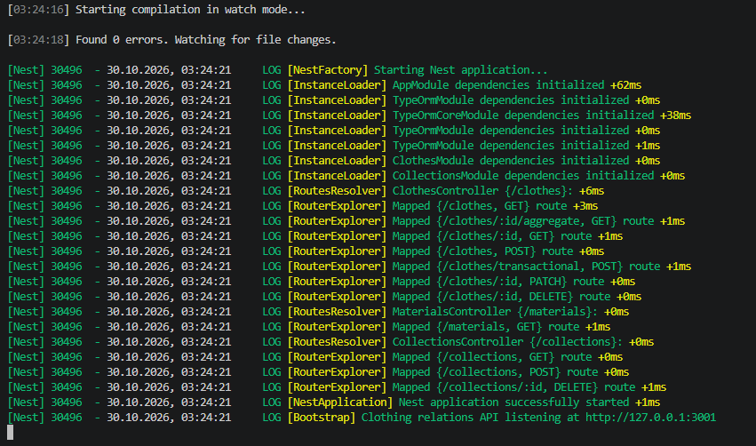

### 6 — Створення сезонної колекції

POST на `/collections` повертає `201 Created`, назву `Autumn Winter 2026` та згенерований UUID, який далі використовується для зв’язку товару з колекцією

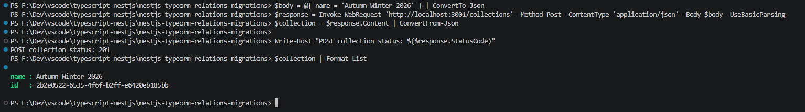

### 7 — Створення товару з трьома типами зв’язків

POST на `/clothes` створює `Sweat Oversized Pullover Hoodie` з ціною `1800.00` та повертає `201`, відповідь містить вкладену колекцію, матеріали `Cotton` і `Polyester` та інструкцію догляду з температурою прання `30`

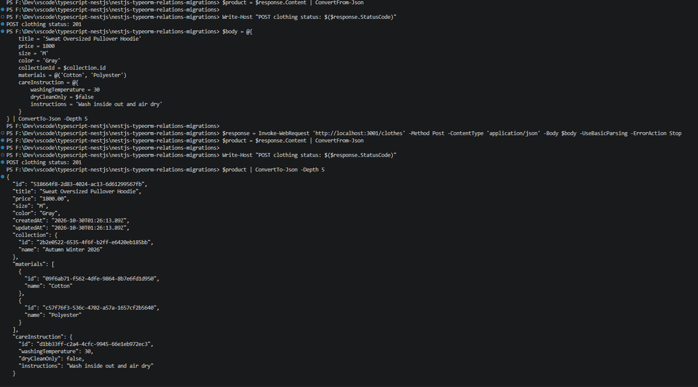

### 8 — Повний агрегат через QueryBuilder

GET на `/clothes/:id/aggregate` повертає `200 OK` і той самий товар з усіма трьома типами зв’язків, одночасно завантаженими через QueryBuilder

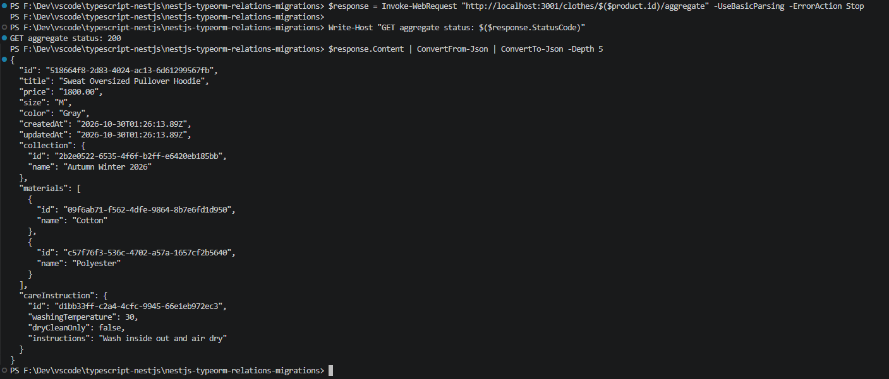

### 9 — Фільтрація за пов’язаними сутностями

Запит із `collectionId` та `material=COTTON` знаходить один товар без урахування регістру назви матеріалу, у відповіді залишаються обидва матеріали `Cotton, Polyester`, метадані містять `total=1`

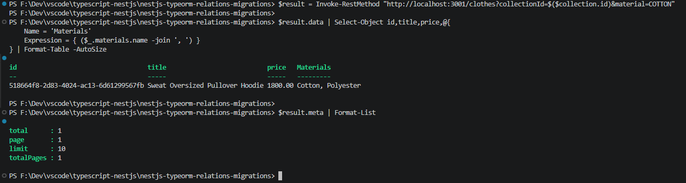

### 10 — Початковий стан перед rollback

Прямий SQL-запит підтверджує наявність одного товару, двох матеріалів, двох рядків таблиці зв’язку та однієї інструкції догляду

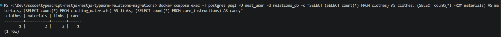

### 11 — Збій усередині транзакції та rollback

Валідний POST на `/clothes/transactional` із `simulateFailure=true` спричиняє збій після збереження товару та матеріалів усередині транзакції, відповідь має статус `400` і повідомлення `transaction rolled back`

Повторний SQL-підрахунок повертає ті самі значення `1 | 2 | 2 | 1`, отже новий товар `Rollback Sample`, матеріал `Rollback Fabric` та їхні зв’язки не залишилися в базі

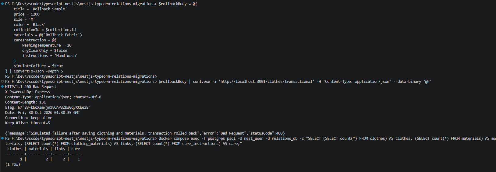

### 12 — Каскадне видалення

DELETE товару повертає `204 No Content`, SQL-підрахунок змінюється на `0 | 2 | 0 | 0`: товар, інструкція догляду та проміжні зв’язки видалені, спільні матеріали збережені

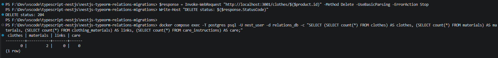

### 13 — Перевірка коду та збірка

`npm run lint` завершується без попереджень і помилок, `npm run typecheck` та `npm run build` виконуються успішно

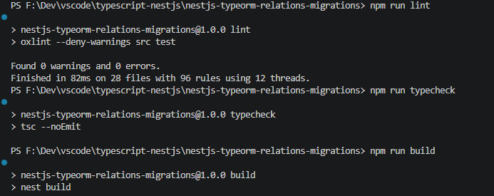

### 14 — Автоматичні тести

Усі 31 тест пройшли, `fail=0`, перевірено міграції та їхній відкат, три типи зв’язків, фільтрацію, транзакції, каскади, цілісність даних, валідацію та збереження агрегата після повторного запуску застосунку

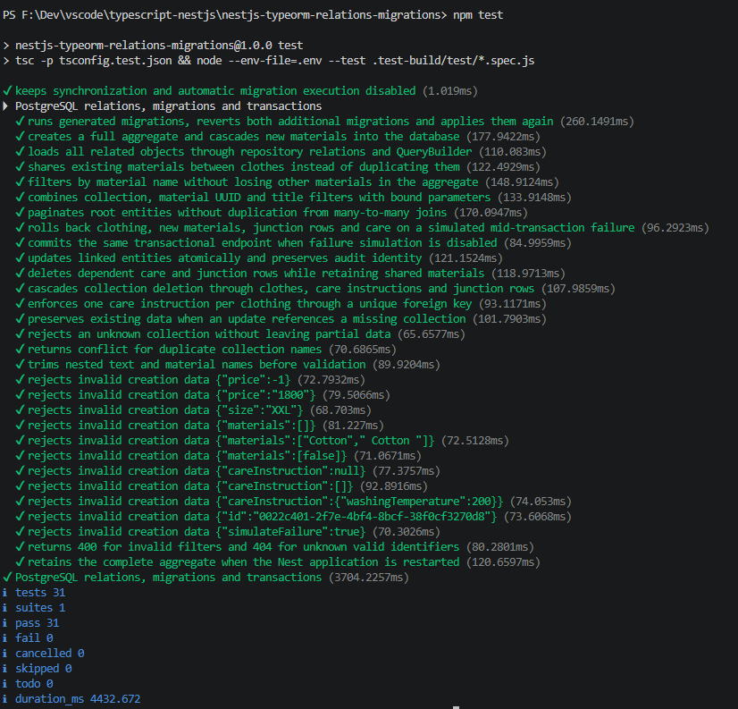
