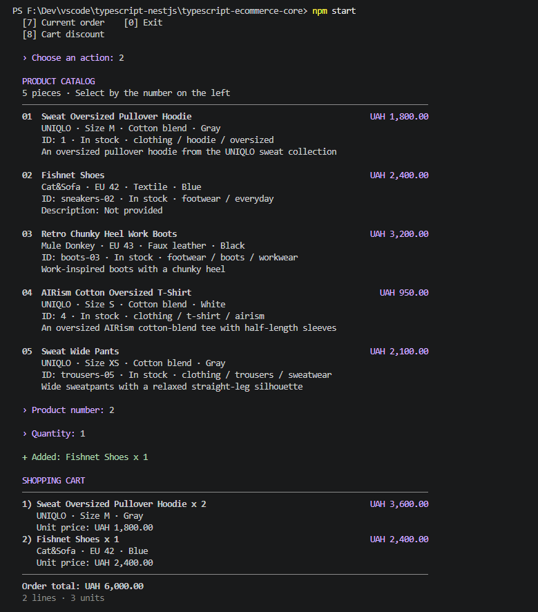
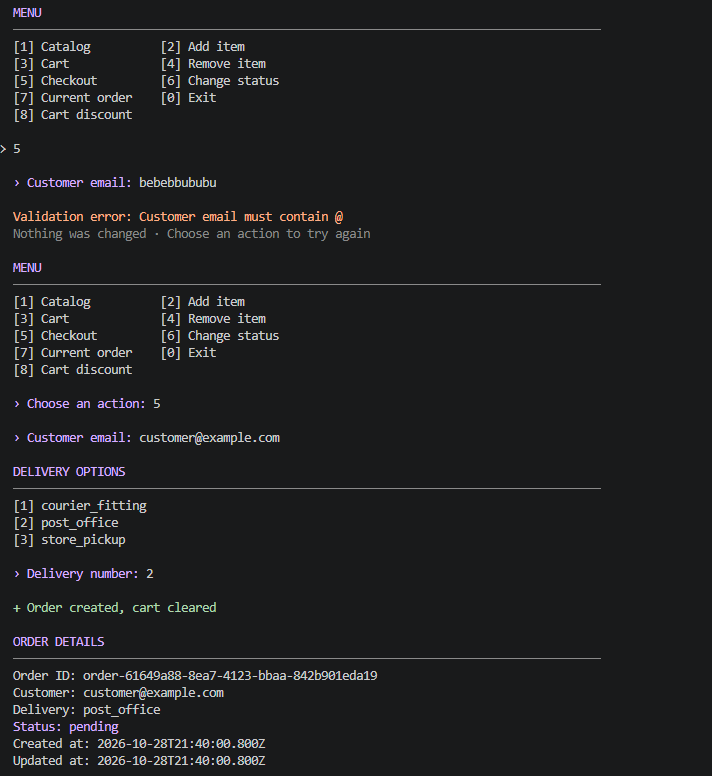
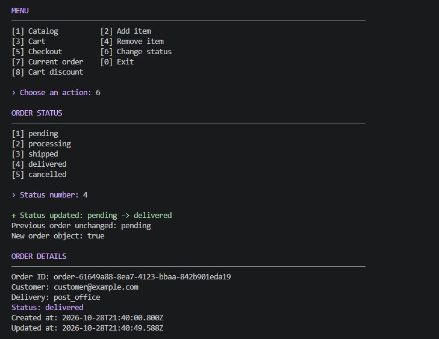
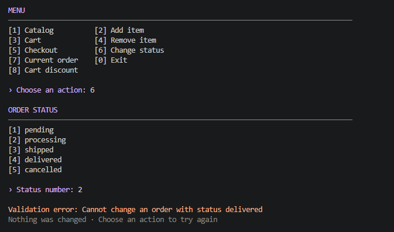
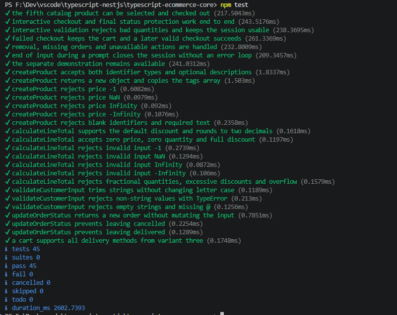

# Типізоване ядро інтернет-магазину

Практична робота № 2

Базові засоби системи типів TypeScript

Реалізовано рівні 1 і 2 для варіанта 3 — магазин одягу та взуття

## Запуск

Потрібні Node.js версії 18.18 або новішої та npm

У терміналі перейти до папки проєкту, підставивши її фактичне розташування

```powershell
cd ".../typescript-ecommerce-core"
```

Встановити залежності за lock-файлом і запустити інтерактивну програму

```powershell
npm ci
npm start
```

Команда `start` виконує `tsx src/index.ts`

## Інтерактивний режим

| Дія                 | Призначення                                           |
| ------------------- | ----------------------------------------------------- |
| `1` — Catalog       | Переглянути каталог і характеристики товарів          |
| `2` — Add item      | Вибрати номер товару та додатну цілу кількість        |
| `3` — Cart          | Переглянути кошик, кількість і підсумок               |
| `4` — Remove item   | Видалити вибрану позицію кошика повністю              |
| `5` — Checkout      | Ввести email та вибрати доставку, створити замовлення |
| `6` — Change status | Вибрати новий статус поточного замовлення             |
| `7` — Current order | Переглянути останнє створене замовлення               |
| `8` — Cart discount | Задати або скасувати відсоткову знижку для кошика     |
| `0` — Exit          | Завершити програму                                    |

Номери товарів, доставок і статусів брати з переліку, який показує програма

Повторне додавання того самого товару збільшує кількість наявної позиції, а після успішного оформлення кошик очищується

Для знижки додати товари до кошика, вибрати `8` і ввести число від `0` до `100`, для дробового відсотка використовувати крапку, значення `0` скасовує знижку

Знижка застосовується до кожної позиції з округленням до двох десяткових знаків, у кошику відображаються початкова сума, відсоток, економія та підсумок до сплати, наприклад для кошика на `6000 грн` знижка `10%` дає `600 грн` економії та `5400 грн` до сплати

Відсоток зберігається в замовленні при оформленні та подальшій зміні статусу, для нового кошика після оформлення або видалення останньої позиції знижка скидається до `0%`

Порожній кошик оформити не можна, некоректний email або вибір доставки не очищують кошик, а помилка вводу повертає до меню без завершення програми

Кількість у кошику має бути додатним цілим числом, тоді як окрема функція `calculateLineTotal` відповідно до ТЗ також підтримує нульову кількість

Дані зберігаються лише протягом поточного запуску, нове оформлення замінює поточне замовлення в меню, запису у файли або базу даних немає

## Перевірка відсутності помилок

```powershell
npm run typecheck
npm run build
npm test
```

`typecheck` і `build` виконують перевірку компілятором TypeScript без створення проміжних JavaScript-файлів, для виконання використовується `tsx`

Тестовий набір містить 45 перевірок, успішний результат — `pass 45`, `fail 0`

Окремо перевіряються розрахунки, числові значення, очищення адреси клієнта, незмінність початкового замовлення, заборона виходу з кінцевих статусів, операції кошика, застосування та скасування знижки, її збереження в замовленні й інтерактивні сценарії через реальний запуск програми

## Рівень 1 — Каталог і типи

- `EntityId` — об’єднання `string | number`
- `BaseProduct` — інтерфейс із `readonly id`, назвою, ціною, опціональним описом, тегами та ознакою наявності
- `Product` — розширення базового товару полями `size`, `material`, `color`
- `FootwearProduct` — додаткова модель взуття з числовим європейським розміром
- `CatalogProduct` — об’єднання моделей одягу та взуття
- `brand` — додаткове поле товару для відображення бренду в каталозі та кошику
- `ClothingSize` — допустимі значення `XS`, `S`, `M`, `L`, `XL`
- `createProduct(productData: Product): Product` — створення окремого об’єкта товару з перевіркою ціни та текстових полів, масив тегів також копіюється
- `calculateLineTotal(price, quantity, discountPercent = 0): number` — розрахунок вартості позиції зі знижкою та округленням до двох десяткових знаків

Від’ємні ціна й кількість спричиняють помилку, додатково відхиляються `NaN`, нескінченні числа, дробова або небезпечна ціла кількість, знижки поза межами 0–100% і переповнення підтримуваного грошового діапазону

Нульова ціна, нульова кількість та знижка 100% дозволені

У `tsconfig.json` задано `ES2022`, `NodeNext`, `strict`, `noImplicitAny`, `strictNullChecks` та `noUncheckedIndexedAccess`, а також додаткові перевірки невикористаних оголошень і точності опціональних полів

## Рівень 2 — Кошик і замовлення

- `OrderStatus` — `pending`, `processing`, `shipped`, `delivered`, `cancelled`
- `DeliveryMethod` — `courier_fitting`, `post_office`, `store_pickup`
- `CartItem` — товар і кількість
- `TimestampMetadata` — `readonly createdAt` та `updatedAt`
- `Order` — модель замовлення, поєднана з `TimestampMetadata` через перетин типів `&`
- `discountPercent` — додаткове опціональне поле замовлення для збереження застосованої знижки, відсутність поля означає `0%`
- `updateOrderStatus(order, newStatus): Order` — повертає новий об’єкт зі зміненим статусом та актуальним `updatedAt`, не змінюючи вхідний об’єкт
- `validateCustomerInput(input: unknown): string` — звужує тип через `typeof`, прибирає зовнішні пробіли та перевіряє непорожній рядок і наявність `@`

Перехід зі статусів `cancelled` і `delivered` до будь-якого іншого статусу заборонено, повторне встановлення того самого кінцевого статусу дозволено

Нерядкові дані клієнта спричиняють `TypeError`, порожній рядок або відсутність `@` — `Error`

Валідація адреси не перевіряє існування пошти

## Файли

| Файл                  | Призначення                                             |
| --------------------- | ------------------------------------------------------- |
| `src/models.ts`       | Типи та інтерфейси товару, кошика й замовлення          |
| `src/catalog.ts`      | Створення товару та розрахунок вартості позиції         |
| `src/orders.ts`       | Створення замовлення та оновлення статусу               |
| `src/validation.ts`   | Спільні перевірки чисел і тексту, обробка вводу клієнта |
| `src/index.ts`        | Точка входу та вибір режиму запуску                     |
| `src/cli.ts`          | Консольне меню, введення та повідомлення про помилки    |
| `src/cart.ts`         | Додавання, видалення та підсумок кошика                 |
| `src/products.ts`     | Спільний каталог товарів для обох режимів               |
| `src/presentation.ts` | Спільне відображення каталогу, кошика й замовлення      |
| `src/demo.ts`         | Готова демонстрація рівнів 1 і 2                        |
| `tests/core.test.ts`  | Перевірки вимог рівнів 1 і 2                            |
| `tests/cart.test.ts`  | Перевірки кошика, створення замовлення та кількості     |
| `tests/cli.test.ts`   | Перевірки повних інтерактивних сесій                    |

## Робота програми

### 1 — Каталог і формування кошика

У кошику два худі по `1800 грн` та одна пара взуття за `2400 грн`, разом `6000 грн`, дві позиції та три одиниці товару



### 2 — Валідація емайлу та оформлення замовлення

Спочатку введено рядок без символу `@`, програма показує `Customer email must contain @` і повертає до меню без втрати кошика

Під час повторного оформлення введено навчальну адресу `customer@example.com` і вибрано доставку `post_office`, створено замовлення зі статусом `pending`, окремим ідентифікатором і однаковими початковими часовими мітками `createdAt` та `updatedAt`, повідомлення `Order created, cart cleared` підтверджує завершення оформлення



### 3 — Незмінне оновлення статусу

Статус того самого замовлення змінено з `pending` на `delivered`, поле `updatedAt` оновлено, а `createdAt`, ідентифікатор, адреса клієнта та доставка залишилися такими самими, як на другому скріншоті

Рядки `Previous order unchanged: pending` і `New order object: true` показують, що функція повернула новий об’єкт, залишивши початковий об’єкт зі старим статусом

Прямий перехід `pending → delivered` дозволено умовами рівня 2, які забороняють лише вихід із кінцевих статусів, обов’язкової послідовності проміжних статусів ТЗ не говрить



### 4 — Захист кінцевого статусу

Після доставки виконано спробу встановити `processing`, програма відхилила дію повідомленням `Cannot change an order with status delivered`

Це очікуваний результат перевірки бізнес-правила, статус замовлення не змінюється, програмою можна користуватися далі, аналогічний захист для `cancelled` перевіряється автоматичними тестами



### Перевірка компіляції та тестів

Для підтвердження відсутності помилок

```powershell
npm run build
npm test
```


